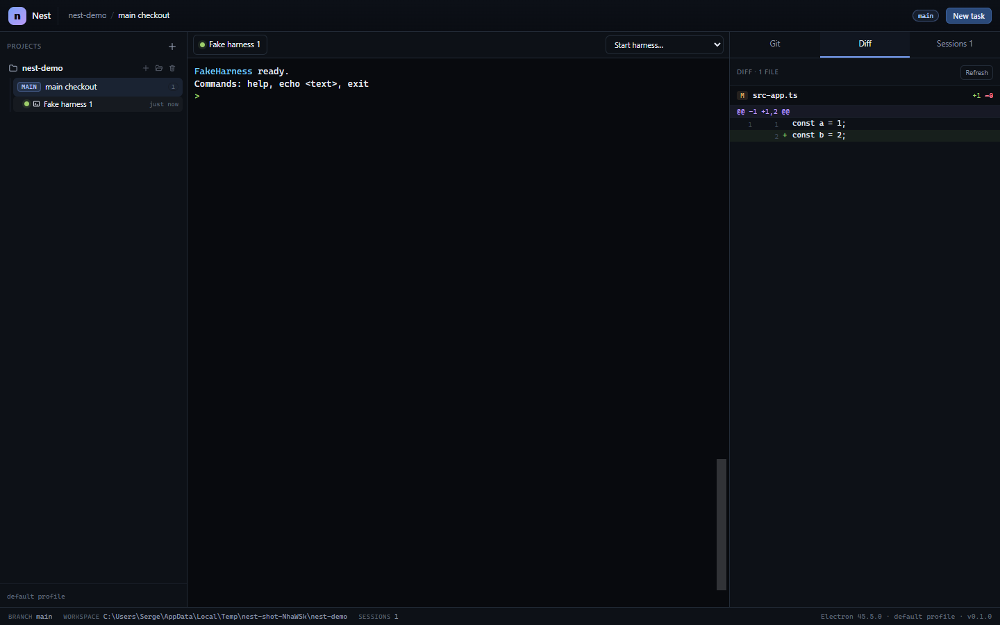
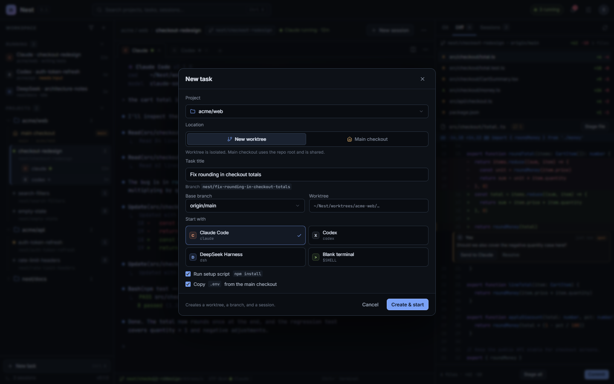

# Nest

Лёгкий desktop-воркспейс для параллельной работы с CLI-агентами. Аналог Orca по сути, но без ботов, браузера, плагинов и нативного чата.

**Статус:** foundation v0.1 собран. Работают: три колонки, проекты и main checkout, worktree-задачи, PTY + xterm, SQLite, git/diff/комментарии, resume завершённой сессии в той же вкладке с точным `harness_session_id`, `FakeHarness` и e2e. OpenCode проверен вручную, Codex/Claude smoke — после MVP. Собирается NSIS-установщик; упакованная и установленная сборка проходят автоматический смоук локально, проверка на чистой Windows ещё впереди.

```
Project (git repo)
├── Main checkout (singleton)
│   └── Session
└── Task (worktree + branch)
    ├── Session (Claude Code / Codex / DSH / OpenCode / pi / Copilot)
    └── Session (второй harness на ту же задачу)
```

Три колонки:

- **слева** — проекты, main checkout, задачи и запущенные harness;
- **в центре** — настоящий терминал с harness CLI;
- **справа** — git, diff с комментариями и сессии.

Windows-first. В MVP нет фонового daemon. Закрытие окна **прячет Nest в трей**: запущенные CLI и PTY продолжают работать, а клик по иконке или повторный запуск возвращает то же окно с теми же терминалами. Полный выход — **Quit Nest** в меню трея: тогда PTY завершаются, а сессии, которые были живы, при следующем запуске **автоматически продолжаются в тех же вкладках** по сохранённому `harness_session_id` (fallback — `--continue` / `resume --last`). `NEST_AUTO_RESUME=0` отключает автозапуск; для остальных завершённых сессий есть кнопка **Resume**.

## Быстрый старт

Нужны Node.js 22.12+ (проверено на 24), pnpm и `git` в `PATH`.

```powershell
pnpm install
pnpm dev
```

Изолированный профиль (отдельные `userData`, БД, worktree-root и single-instance lock) — удобно для чистой БД и экспериментов:

```powershell
$env:NEST_PROFILE="scratch"; pnpm dev
```

Профиль переключает `userData`, `nest.db`, worktree-root и single-instance lock.

Закрытие окна не завершает приложение: Nest остаётся в трее, а запущенные CLI продолжают работать. Открыть окно снова — клик по иконке Nest в трее или повторный запуск. Полный выход — **Quit Nest** в меню трея; после него живые сессии автоматически продолжатся при следующем запуске.

Проверки:

```powershell
pnpm typecheck
pnpm lint
pnpm test        # unit + PTY integration
pnpm build
pnpm test:e2e    # FakeHarness: старт, ввод, рестарт, scrollback
pnpm dist        # NSIS-установщик в apps/desktop/release
```

`FakeHarness` запускается через `node`, поэтому в dev-окружении Node должен быть в `PATH`. Реальные harness-профили ищутся по `where`/`which` и показываются в UI как доступные или отсутствующие.

`pnpm test:e2e` дополнительно прогоняет `e2e/packaged.spec.ts`, если уже собран `apps/desktop/release/win-unpacked`: установленное приложение должно стартовать, поднять PTY из `resources/fake-harness.mjs` и создать БД. Без собранного релиза шаг пропускается. Тот же смоук можно направить на установленную копию через `NEST_E2E_EXE`.

## Структура

```text
apps/desktop        Electron main / preload / renderer
packages/shared     zod-схемы, RPC-контракт, harness-типы
packages/core       SQLite, миграции, git, PTY, sessions, comments
packages/ui         Button / Badge / EmptyState и другие примитивы
scripts             fake-harness.mjs
docs                продукт, архитектура, roadmap, макеты
```

## Скриншоты

### Workspace


### Foundation — реальное приложение



`FakeHarness` в main checkout, git и diff.

### Git


### Sessions


### New task



Интерактивный макет: [`docs/mockups/preview.html`](docs/mockups/preview.html). Можно открыть в браузере и переключать экраны сверху.

### Архитектура


## Документы

- [Продукт: идея, модель, сценарии, требования](docs/product.md)
- [Архитектура: стек, процессы, PTY, git, БД, безопасность](docs/architecture.md)
- [Harness compatibility: Claude, Codex, DSH, OpenCode, pi, Copilot](docs/harness-compat.md)
- [Roadmap: MVP, фазы, риски, открытые вопросы](docs/roadmap.md)

## Коротко о стеке

**Electron 45** + React + TypeScript, `node-pty` + `xterm.js`, SQLite через встроенный `node:sqlite`, системный `git`. Ядро — отдельный пакет на Node; daemon для выживания сессий — позже, remote/SSH — долгий ящик.

Tauri 2 не входит в MVP, но оставлен как future experiment: если понадобится установщик < 30 МБ или мобильный клиент, делаем отдельный spike и сравниваем на цифрах. Подробнее — [ADR-001](docs/architecture.md#0-принятые-решения).

## Коротко о модели

- **Project** — зарегистрированный git-репозиторий.
- **Main checkout** — singleton-воркспейс проекта в корне репозитория, без worktree. Создаётся автоматически, не удаляется.
- **Task** — работа в отдельном `git worktree` + ветка `nest/<slug>`.
- **Session** — PTY-процесс с harness CLI; у задачи или main checkout может быть несколько сессий.
- **Comment** — локальный комментарий к строке diff; можно отправить в активную сессию.
- **Harness** — профиль команды: Claude Code, Codex, DeepSeek Harness, OpenCode, pi, GitHub Copilot CLI, custom.

## Что сознательно не входит в MVP

Нативный чат, browser/design mode, bots, Slack/Linear/Jira, плагины, split panes, Monaco, аккаунты, PR-провайдеры, фоновый daemon. Remote/SSH и mobile — долгий ящик, сценария пока нет.

## Следующий шаг

Foundation собран; точный resume по session id, fallback на последнюю беседу и авто-возобновление работают. NSIS-установщик собирается, упакованная и установленная сборка проходят локальный смоук. Разработка идёт одним потоком, без dev worktree и параллельных веток. Дальше по порядку:

1. Поставить локальный тег `foundation-v0.1` как базовую точку.
2. Phase 3: search и links в терминале, copy/paste shortcuts, лимит смонтированных xterm. Phase 2 закрыта: fetch, setup script с `.env`, dirty-check, выбор location, прогресс создания и running-секция работают.
3. Прогнать установщик на чистой Windows без Node.js, когда будет машина.
4. Smoke **Codex** в самом Nest — после MVP, по договорённости. OpenCode уже проверен: id захватывается, после рестарта продолжается та же беседа.

Подробный план и таблица discovery — в [roadmap](docs/roadmap.md#точный-resume-по-session-id-сделано).
