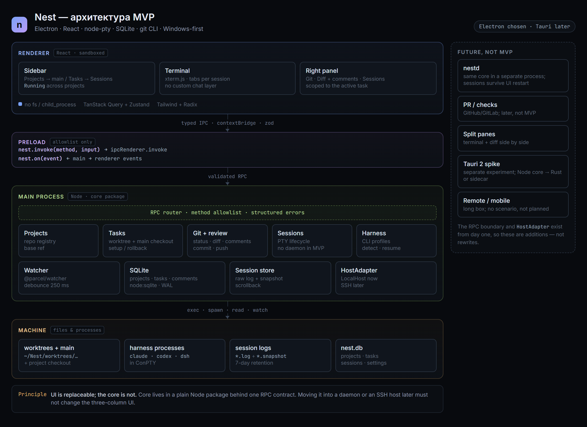

# Nest — архитектура



## 0. Принятые решения

| # | Решение | Следствие |
|---|---|---|
| ADR-001 | **Electron**, не Tauri | проверенный `node-pty` + `xterm` на Windows; Tauri 2 остаётся future experiment, не MVP |
| ADR-002 | **Windows-first** | Windows 11 — основной таргет CI и ручных тестов; macOS вторичен; Linux best effort |
| ADR-003 | **Main checkout — singleton-workspace проекта** | можно работать без worktree; один на проект, не удаляется, сессии и git доступны |
| ADR-004 | **Без daemon в MVP** | Закрытие окна скрывает Nest в трей, PTY продолжают работать; полный выход завершает PTY, а живые сессии автоматически возобновляются через resume harness; scrollback сохраняется |
| ADR-005 | **Harness-профили MVP** | Claude Code, Codex, DeepSeek Harness, OpenCode, pi, GitHub Copilot CLI, ZCode, Qwen Code, встроенный терминал, custom |
| ADR-006 | **Комментарии к diff — в MVP** | хранятся в SQLite, привязаны к task/file/line, отправляются в активную PTY-сессию |
| ADR-007 | **PR-провайдеров нет в MVP** | только commit/push; GitHub/GitLab PR и checks — позже |
| ADR-008 | **Remote/SSH/mobile — долгий ящик** | `HostAdapter` остаётся тонким и локальным; remote не проектируем |
| ADR-009 | **Без spike** | Orca подтвердила Electron + PTY + worktrees; начинаем сразу с Phase 1 |
| ADR-010 | **SQLite через `node:sqlite`** | встроен в Node 24 внутри Electron 45: не нужен native rebuild, WAL, синхронный API; при необходимости переход на `better-sqlite3` — за тонким интерфейсом `Db` |
| ADR-011 | **Единый контекст изменений на задачу** (реализовано) | `Source Control`, список и diff используют общее состояние выбранного workspace; Git и существующий IPC остаются источником данных, см. §7.2.2 |

Tauri-заметка: если позже понадобится установщик < 30 МБ, мобильный клиент или минимальный runtime, делаем отдельный spike на Tauri 2 + `portable-pty` + `xterm`. Это не «переезд одной кнопкой»: Node-core придётся переписать на Rust или тащить sidecar. Поэтому решение по Tauri принимается отдельно и по цифрам, а не по умолчанию.

## 1. TL;DR

| Слой | Выбор |
|---|---|
| Desktop shell | Electron 45 |
| UI | React 19 + TypeScript + Vite (`electron-vite`) |
| Стили | Tailwind CSS 4 + дизайн-токены и собственные примитивы в `packages/ui` |
| Состояние | React state в foundation; Zustand + TanStack Query — когда появится необходимость |
| Терминал | `@xterm/xterm` + `@xterm/addon-fit` + `@xterm/addon-search` |
| PTY | `node-pty` (ConPTY на Windows) |
| БД | SQLite через `node:sqlite` (Node 24 в Electron 45), WAL |
| Git | системный `git` через `node:child_process` |
| Watcher | `@parcel/watcher` на workspace и git-каталоге проекта; debounce 350 мс, событие `git:changed` на задачу |
| Diff | `git diff` + собственный парсер; режимы `both`/`unstaged`/`staged`/`base`, каждый ответ несёт дескриптор сравнения; виртуализированный viewer и подсветка Shiki (JS engine, грамматики по требованию) |
| Review comments | SQLite + inline threads в diff; отправка в активную PTY-сессию |
| PR | не в MVP; GitHub/GitLab и checks — позже |
| Валидация | `zod` на границе IPC |
| Сборка | `electron-builder` (NSIS / dmg / AppImage) |
| Тесты | Vitest + Playwright |
| Платформы | Windows-first; macOS вторичен; Linux best effort |
| Task kinds | `worktree` (по умолчанию) + `checkout` (singleton main checkout) |
| Сессии | без daemon в MVP: закрытие окна прячет приложение в трей и PTY живут; полный выход завершает PTY, живые сессии возобновляются через `--continue`/`resume` |

Монорепозиторий на pnpm. Ядро (`packages/core`) — обычный Node-код, который сейчас живёт в main-процессе, а позже может быть вынесен в отдельный daemon без переписывания UI.

## 2. Почему Electron, а не Tauri

Nest — это на 70% терминал и процессы, а не рендеринг. В этом месте у Electron есть проверенный стек:

- `node-pty` — де-факто стандарт PTY для Electron, включая ConPTY на Windows;
- `xterm.js` — тот же терминал, что в VS Code;
- весь код на TypeScript, без переключения контекста в Rust;
- Orca сама построена на Electron, то есть модель проверена на Windows;
- проще нанимать людей и переиспользовать примеры.

Минусы: размер дистрибутива (~120–180 МБ) и память. Для инструмента, который держит 3–10 терминалов, это приемлемо.

**Tauri 2** — разумная альтернатива, если критичен размер (~10–20 МБ). Но тогда PTY, git и файловые операции уходят в Rust (`portable-pty`, `git2`/CLI, `rusqlite`), а это больше работы и больше платформенных сюрпризов на Windows. Решение: начать на Electron, не смешивать слои, чтобы при необходимости заменить shell. Tauri-спайк — отдельный эксперимент после MVP, не часть текущего scope (ADR-001).

**VS Code extension** — дешёвый UI, но мы получаем чужие ограничения на layout, процессы и распространение. Не подходит.

## 3. Процессы и слои

```
┌──────────────────────────── Electron ────────────────────────────┐
│                                                                  │
│  Renderer (React)                                                │
│  ┌──────────────┬──────────────────────────┬──────────────────┐  │
│  │ Sidebar      │ Terminal (xterm.js)      │ Git / Diff /     │  │
│  │ Projects     │ Session tabs             │ Comments /       │  │
│  │              │                          │ Sessions         │  │
│  └──────────────┴──────────────────────────┴──────────────────┘  │
│          │ typed IPC (contextBridge, zod)                        │
│  Preload │ allowlisted API, no node integration                  │
│          │                                                       │
│  Main process                                                    │
│  ┌────────────────────────────────────────────────────────────┐  │
│  │ RPC router                                                 │  │
│  │   ├─ ProjectService                                        │  │
│  │   ├─ TaskService ── GitService ── git CLI                  │  │
│  │   ├─ SessionService ── node-pty ── harness process         │  │
│  │   ├─ HarnessRegistry                                       │  │
│  │   ├─ CommentService                                        │  │
│  │   ├─ Watcher (@parcel/watcher)                              │  │
│  │   └─ Db (node:sqlite, WAL)                                 │  │
│  └────────────────────────────────────────────────────────────┘  │
│          │                                                       │
│  SQLite (nest.db)   session logs / snapshots   worktrees on disk │
└──────────────────────────────────────────────────────────────────┘
```

Почему ядро не в renderer:

- PTY, файлы и git не должны жить в sandboxed renderer;
- при перезапуске окна процессы и состояние не должны зависеть от UI;
- ядро можно позже вынести в `nestd` и подключить по named pipe / WebSocket.

Почему не отдельный daemon сразу:

- для MVP это лишняя сложность (IPC, lifecycle, версионирование протокола);
- но границы (`HostAdapter`, RPC-контракт) проектируем так, чтобы вынос был механическим.

## 4. Модули

### `packages/shared`

- zod-схемы доменных объектов;
- типы RPC-контракта и событий;
- общие утилиты: slug, branch name, форматирование, пути.

### `packages/core`

Чистый Node, без импортов Electron.

| Модуль | Ответственность |
|---|---|
| `db` | подключение SQLite, миграции, prepared statements |
| `projects` | регистрация репозиториев, base ref, настройки |
| `tasks` | worktree + main checkout, статусы, архив |
| `git` | status, diff, stage, commit, push, worktree list; для checkout — корень проекта |
| `comments` | review comments: CRUD, anchor task/file/line, отправка в сессию |
| `sessions` | запуск PTY, lifecycle, статусы, scrollback; без daemon в MVP |
| `settings` | настройки приложения: отключённые harness-профили, custom-команда |
| `harness` | реестр профилей, detect installed, resume |
| `hosts` | `HostAdapter`; сейчас только `LocalHost` |
| `rpc` | регистрация методов, валидация, ошибки |

`watcher` живёт в `apps/desktop/src/main`: `@parcel/watcher` — нативный модуль, а main-бандл выносит зависимости наружу, поэтому `packages/core` остаётся чистым Node-кодом без нативных require.

### `apps/desktop/src/main`

- создание `BrowserWindow`;
- wiring core-сервисов;
- IPC-роутер;
- `WorkspaceWatcher`: `@parcel/watcher` на каждый workspace и на общий git-каталог проекта, debounce и `git:changed`;
- tray и системные уведомления: клик по уведомлению показывает окно и открывает сессию; deep links — позже;
- graceful shutdown: остановить PTY, закрыть watcher, checkpoint БД.

### `apps/desktop/src/preload`

- `contextBridge.exposeInMainWorld('nest', ...)`;
- только `invoke(method, input)` и `on(event, handler)`;
- никаких прямых `ipcRenderer`, `fs`, `child_process`.

### `apps/desktop/src/renderer`

- layout и экраны;
- TanStack Query для `projects/tasks/sessions/git`;
- Zustand для выбранной задачи, таба, размеров панелей;
- xterm-инстансы в отдельном реестре, чтобы переживать переключение задач.

### `packages/ui`

- кнопки, инпуты, табы, диалоги, статус-точки;
- тема (dark first), типографика, иконки.

## 5. RPC-контракт

Один типизированный канал. Все входы валидируются zod, все ошибки — структурированные.

Набросок ниже фиксирует форму контракта; актуальный список методов и схем — `packages/shared/src/rpc.ts`.

```ts
// packages/shared/src/rpc.ts
import { z } from 'zod';

export const ProjectSchema = z.object({
  id: z.string(),
  name: z.string(),
  path: z.string(),
  baseRef: z.string(),
  createdAt: z.number(),
});

export const TaskSchema = z.object({
  id: z.string(),
  projectId: z.string(),
  title: z.string(),
  kind: z.enum(['worktree', 'checkout']),
  branch: z.string(),
  workspacePath: z.string(),
  baseRef: z.string(),
  status: z.enum(['creating', 'active', 'review', 'done', 'archived', 'error']),
});

export const SessionSchema = z.object({
  id: z.string(),
  taskId: z.string(),
  harnessId: z.string(),
  title: z.string(),
  status: z.enum(['starting', 'running', 'idle', 'needs_input', 'exited', 'failed']),
  pid: z.number().optional(),
  startedAt: z.number(),
  endedAt: z.number().optional(),
  exitCode: z.number().optional(),
});

export const CommentSchema = z.object({
  id: z.string(),
  taskId: z.string(),
  path: z.string(),
  side: z.enum(['old', 'new']),
  line: z.number().int().positive(),
  body: z.string(),
  status: z.enum(['open', 'sent', 'resolved']),
  sessionId: z.string().optional(),
  createdAt: z.number(),
  updatedAt: z.number(),
  sentAt: z.number().optional(),
});

export const rpcContract = {
  'projects.list':   { input: z.void(), output: z.array(ProjectSchema) },
  'projects.add':    { input: z.object({ path: z.string() }), output: ProjectSchema },
  'projects.remove': { input: z.object({ id: z.string() }), output: z.void() },

  'tasks.list':   { input: z.object({ projectId: z.string().optional() }), output: z.array(TaskSchema) },
  'tasks.create': { input: z.object({
    projectId: z.string(),
    title: z.string().min(1),
    location: z.enum(['worktree', 'checkout']).default('worktree'),
    baseRef: z.string().optional(),
    harnessId: z.string().optional(),
  }), output: TaskSchema },
  'tasks.delete': { input: z.object({ id: z.string(), deleteBranch: z.boolean() }), output: z.void() },
  'tasks.mainCheckout': { input: z.object({ projectId: z.string() }), output: TaskSchema },

  'sessions.start':  { input: z.object({ taskId: z.string(), harnessId: z.string(), cols: z.number(), rows: z.number() }), output: SessionSchema },
  'sessions.write':  { input: z.object({ id: z.string(), data: z.string() }), output: z.void() },
  'sessions.resize': { input: z.object({ id: z.string(), cols: z.number(), rows: z.number() }), output: z.void() },
  'sessions.stop':   { input: z.object({ id: z.string(), force: z.boolean().optional() }), output: z.void() },
  'sessions.list':   { input: z.object({ taskId: z.string().optional() }), output: z.array(SessionSchema) },

  'git.status': { input: z.object({ taskId: z.string() }), output: GitStatusSchema },
  'git.diff':   { input: z.object({ taskId: z.string(), path: z.string().optional(), mode: DiffModeSchema.optional() }), output: GitDiffSchema /* files + descriptor */ },
  'git.stage':  { input: z.object({ taskId: z.string(), paths: z.array(z.string()) }), output: GitStatusSchema },
  'git.unstage':{ input: z.object({ taskId: z.string(), paths: z.array(z.string()) }), output: GitStatusSchema },
  'git.commit': { input: z.object({ taskId: z.string(), message: z.string().min(1), stageAll: z.boolean().optional(), amend: z.boolean().optional() }), output: z.object({ hash: z.string(), summary: z.string() }) },
  'git.push':   { input: z.object({ taskId: z.string(), force: z.boolean().optional(), publish: z.boolean().optional() }), output: z.object({ output: z.string() }) },
  'git.log':    { input: z.object({ taskId: z.string(), ref: z.string().optional(), limit: z.number().int().optional(), skip: z.number().int().optional() }), output: GitLogSchema },
  'git.commitDetail': { input: z.object({ taskId: z.string(), hash: z.string() }), output: GitCommitDetailSchema },
  'git.branches': { input: z.object({ taskId: z.string() }), output: GitBranchesSchema },
  'git.compare': { input: z.object({ taskId: z.string(), base: z.string(), head: z.string().optional() }), output: GitCompareSchema },
  'git.fetch':  { input: z.object({ taskId: z.string() }), output: z.object({ output: z.string() }) },
  'git.pull':   { input: z.object({ taskId: z.string() }), output: z.object({ output: z.string() }) },
  'git.checkout': { input: z.object({ taskId: z.string(), branch: z.string(), create: z.boolean().optional(), from: z.string().optional() }), output: GitStatusSchema },
  'git.discard': { input: z.object({ taskId: z.string(), paths: z.array(z.string()) }), output: GitStatusSchema },

  'comments.list':   { input: z.object({ taskId: z.string(), path: z.string().optional() }), output: z.array(CommentSchema) },
  'comments.create': { input: z.object({
    taskId: z.string(),
    path: z.string(),
    side: z.enum(['old', 'new']),
    line: z.number().int().positive(),
    body: z.string().min(1),
  }), output: CommentSchema },
  'comments.update': { input: z.object({
    id: z.string(),
    body: z.string().min(1).optional(),
    status: z.enum(['open', 'sent', 'resolved']).optional(),
  }), output: CommentSchema },
  'comments.delete': { input: z.object({ id: z.string() }), output: z.void() },
  'comments.send':   { input: z.object({
    ids: z.array(z.string()).min(1),
    sessionId: z.string().optional(),
  }), output: z.object({ sent: z.number(), sessionId: z.string() }) },
};
```

Настройки приложения (фактические методы):

```ts
'harness.list':    { input: z.object({ includeDisabled: z.boolean().optional() }), output: z.array(HarnessProfileSchema) },
'settings.get':    { input: z.void(), output: AppSettingsSchema },
'settings.update': { input: AppSettingsSchema.partial(), output: AppSettingsSchema },
'notifications.show':  { input: z.object({ title: z.string(), body: z.string(), sessionId: z.string().optional(), urgent: z.boolean().optional() }), output: z.object({ shown: z.boolean() }) },
'notifications.badge': { input: z.object({ count: z.number().int() }), output: z.void() },
```


События main → renderer:

```ts
export type NestEvent =
  | { type: 'session:data'; sessionId: string; data: string }
  | { type: 'session:status'; sessionId: string; status: SessionStatus; exitCode?: number }
  | { type: 'task:updated'; task: Task }
  | { type: 'task:progress'; taskId: string; step: string; message?: string }
  | { type: 'git:changed'; taskId: string }
  | { type: 'notification'; level: 'info' | 'warn' | 'error'; title: string; body: string }
  | { type: 'notification:activated'; sessionId?: string };
```

`git:changed` адресован конкретной задаче. Renderer хранит счётчик версии на `taskId` и перезапрашивает status/diff только для выбранной задачи, поэтому события из чужих worktree не дёргают открытые панели.

Сессии в renderer — reducer (`state/sessions.ts`): событие обновляет только свою строку, локальное закрытие ставит tombstone, а `sessions.list` сливается по ревизии, снятой перед запросом. Поздний ответ поэтому не воскрешает закрытые вкладки и не теряет запущенные за время запроса. Выбранная вкладка запоминается на задачу (`state/sessionTabs.ts`), так что A → B → A возвращает терминал A; дефолт (последняя живая) применяется только если её больше нет.

Preload:

```ts
contextBridge.exposeInMainWorld('nest', {
  invoke: (method: keyof typeof rpcContract, input: unknown) =>
    ipcRenderer.invoke('nest:rpc', method, input),
  on: (handler: (event: NestEvent) => void) => {
    const listener = (_: unknown, event: NestEvent) => handler(event);
    ipcRenderer.on('nest:event', listener);
    return () => ipcRenderer.removeListener('nest:event', listener);
  },
});
```

Правила:

- renderer не передаёт произвольные shell-команды; только `harnessId` из реестра;
- все пути проверяются: должны лежать внутри зарегистрированного проекта/worktree;
- ошибки имеют код (`GIT_DIRTY`, `WORKTREE_EXISTS`, `HARNESS_NOT_FOUND`, `PTY_SPAWN_FAILED`);
- долгие операции возвращают `operationId` и стримят прогресс событиями.

## 6. PTY и терминал

### 6.0 Последовательность запуска

```
User            Renderer              Main / Core             Machine
 │  New task       │                       │                     │
 ├────────────────►│  tasks.create         │                     │
 │                 ├──────────────────────►│  git worktree add   │
 │                 │                       ├────────────────────►│
 │                 │                       │  insert task row    │
 │                 │  task:updated         │                     │
 │                 │◄──────────────────────┤                     │
 │                 │  sessions.start       │                     │
 │                 ├──────────────────────►│  node-pty.spawn     │
 │                 │                       ├────────────────────►│
 │                 │  session:data         │  stdout/stderr      │
 │                 │◄──────────────────────┤◄────────────────────┤
 │  type in term   │                       │                     │
 ├────────────────►│  sessions.write       │                     │
 │                 ├──────────────────────►│  pty.write          │
 │                 │                       ├────────────────────►│
```

### 6.1 Запуск

```ts
import * as pty from 'node-pty';

const proc = pty.spawn(command, args, {
  name: 'xterm-256color',
  cols,
  rows,
  cwd: workspacePath,
  env: { ...process.env, ...profile.env, NEST_SESSION_ID: sessionId },
  useConpty: process.platform === 'win32',
});
```

Windows-нюанс: `claude`, `codex`, `dsh` часто являются `.cmd`-шимами. `node-pty` не запускает `.cmd` напрямую. Решение:

- резолвить команду через `where.exe` / `which`;
- если это `.cmd`/`.bat`, запускать `cmd.exe /d /s /c "<command> <args>"`;
- аргументы экранировать по правилам Windows (`windowsVerbatimArguments` / собственная функция);
- логировать фактическую команду в session metadata для диагностики.

### 6.2 Поток данных

```
pty.onData(chunk)
  → буфер сессии + монотонная позиция (сразу, до отправки)
  → batch: 8 ms или 64 KB ожидающей очереди
  → webContents.send('nest:event', { type:'session:data', data, start, end })
  → renderer: подписка → snapshot → только байты после position
```

- batching обязателен: TUI-агенты выдают много мелких escape-последовательностей; 200
  микро-chunk'ов превращаются в одно событие, а очередь ограничена порогом 64 KB;
- **позиция потока** — число UTF-16 units, полученных сессией с момента создания. Позиция
  растёт монотонно даже когда буфер обрезан (4 MB) или сессия перезапущена через resume, поэтому
  она и есть единственные часы для стыковки истории с live-выводом. Каждое `session:data` несёт
  диапазон `[start, end)` и `end - start === data.length`;
- `pty.pause()` по ack renderer'а описан в архитектуре как backpressure, но в текущем срезе не
  реализован: очередь ограничена размером batch, а не окном подтверждений;
- для 10+ сессий можно перейти на `MessageChannelMain` (отдельный port на сессию), но это
  оптимизация, не MVP.

**Стыковка истории и live-вывода.** `sessions.scrollback` возвращает `{ data, position }` —
snapshot и позицию, которую он покрывает. Renderer сначала подписывается на `session:data`,
буферизует live-chunk'и, затем получает snapshot, пишет его и только после этого пишет буферные
chunk'и, у которых `end > position`, в исходном порядке, обрезая пересечение по позиции. Так
reload или LRU-remount не дублирует и не переставляет данные, а ANSI-последовательность
собирается из непрерывных байтов. После `dispose()` xterm не получает ни одной записи.

### 6.3 Resize

- `FitAddon.fit()` на `ResizeObserver` контейнера;
- debounce 50 мс;
- `pty.resize(cols, rows)`;
- при скрытом табе не ресайзить, а запомнить размеры и применить при показе.

### 6.4 Scrollback и восстановление

Хранится в SQLite в колонках `scrollback` и `stream_position` (позиция = конец сохранённых
данных). Уровни записи:

1. **Crash snapshot** — раз в 5 секунд по dirty-флагу пишется хвост буфера (не больше 256 KB) и
   его позиция. Запись идёт с таймера, не из `onData`, поэтому не удорожает путь каждого chunk'а.
   Цена: `UPDATE` на 256 KB на сессию, ~1–3 ms (WAL, локальный SSD) — на 10 сессий ~0.5 MB/s.
   Принятое окно потери при аварии: вывод за последние ≤5 s, а восстановленный хвост никогда не
   превышает 256 KB.
2. **Exit / graceful shutdown** — пишется весь буфер (до 4 MB), поэтому штатное завершение
   ничего не теряет.

Recovery не заявляет больше, чем сохранено: `stream_position` всегда равен концу сохранённого
snapshot'а, resume прибавляет к нему маркер и продолжает счёт. Решение о автозапуске принимает
явный маркер `stop_requested`, а не незавершённый статус: сессия, остановленная Stop, остаётся
finished после Quit/рестарта.

При открытии сессии:

- если процесс жив — создаём xterm, пишем snapshot и продолжаем поток с его позиции;
- если процесс умер — пишем сохранённый snapshot; больше данных нет, поэтому «хвоста» после
  него не бывает (он был потерян аварией и не заявлялся);
- если snapshot пуст — сессия открывается с пустого экрана.

Сериализация экрана headless-xterm (`@xterm/headless` + `@xterm/addon-serialize`) остаётся
отдельным улучшением: сейчас snapshot — это сырой ANSI-хвост, а не экран.

### 6.5 Инстансы терминалов

- Держим смонтированными до 8 xterm-инстансов (активные + недавние).
- Порядок LRU по выбранной сессии: выбранная поднимается в начало, девятая вытесняется.
- Вытесненный терминал dispose-ится; PTY продолжает работать, новый вывод копится в scrollback, и при повторном выборе xterm монтируется заново и проигрывает сохранённый scrollback.
- При переключении задачи не убиваем PTY; скрываем контейнер.
- Крестик на вкладке (или средний клик) закрывает её окончательно: PTY останавливается, строка сессии и scrollback удаляются из БД; `Stop` в терминале, наоборот, оставляет сессию для resume.
- Кнопка `+` открывает новую вкладку, стрелка рядом — общий пикер профилей (Terminal + агенты). Что делает сам `+`, задаёт настройка `newSessionDefault`: `ask` (пикер) или конкретный профиль.
- Секция **Activity** в сайдбаре показывает не все открытые вкладки, а только те, что требуют внимания: `Working` (PTY выдаёт вывод), `Idle` (агент затих, но процесс жив) и `Finished` (завершился, пока пользователь смотрел другое). Выбранная вкладка и простой shell в `Idle` не попадают. `Idle` намеренно не утверждает, что агент ждёт ответа: без hooks Nest не отличает вопрос от законченного хода, поэтому `needs_input` в статусах нет. Сессии всех задач остаются видимы в дереве проектов, даже когда задача не активна.

### 6.6 Жизненный цикл и приложение

В MVP **нет фонового daemon**, но закрытие окна не убивает работу:

- при закрытии окна Nest скрывается в трей, PTY-процессы и xterm продолжают жить; повторный клик по иконке или запуск Nest показывает то же окно и те же терминалы;
- полный выход (**Quit Nest** в меню трея) завершает все PTY-процессы;
- сессии, которые были живы в этот момент, помечаются `resume_on_start = 1`;
- при следующем запуске они автоматически возобновляются в тех же вкладках: по сохранённому `harness_session_id`, если он `exact`, иначе через `--continue` / `resume --last` (latest); `heuristic` id автоматически не применяется никогда;
- id беседы определяется discovery-адаптером после старта: OpenCode — `session list --format json`, Codex/pi/Claude/Qwen — свежие JSONL по `cwd`, Copilot — `workspace.yaml`; поиск повторяется после ввода. `exact` получает только id, который напечатал сам запущенный процесс, либо единственная беседа, появившаяся после старта, когда на том же `cwd` нет второй вкладки; при неоднозначности id не записывается (остаётся latest). Один id не может принадлежать двум сессиям проекта: перед записью идёт claim-проверка в БД;
- автоматическое latest-возобновление не запускается, если на том же `cwd` есть другая вкладка того же harness: `--continue` мог бы открыть её беседу;
- в БД сессии, завершившиеся сами или остановленные пользователем, помечаются `exited`/`failed`;
- snapshot/scrollback сохраняется, новый вывод дописывается после маркера `── resume <harness> ──`;
- для остальных завершённых сессий доступна кнопка `Resume exact` / `Resume latest`; неудачный exact-resume сбрасывает id и оставляет сессию для latest-повтора;
- `NEST_AUTO_RESUME=0` отключает автозапуск.

Это осознанное упрощение: PTY переживает закрытие окна, пока приложение живёт в трее, но не полный выход из процесса или перезагрузку. Полное выживание PTY без перезапуска CLI после Quit — отдельный этап с `nestd`, после MVP.

### 6.7 Безопасность терминала

- `allowProposedApi: true` только ради decorations у `@xterm/addon-search`; xterm закреплён версией, а приложение не исполняет код из PTY-потока как API;
- ссылки в выводе — `@xterm/addon-web-links`, открываются по Ctrl/Cmd+клику через `app.openExternal`, который пропускает только `http:`, `https:` и `mailto:`;
- clipboard: `Ctrl+Shift+C/V` на Linux/Windows, `Cmd+Shift+C/V` на macOS; `Ctrl+C` копирует только когда есть выделение, иначе уходит в PTY как SIGINT;
- не интерпретировать вывод агента как HTML.

### 6.8 Уведомления и непрочитанное

Политика живёт в renderer: только он знает, открыта ли эта сессия и в фокусе ли окно. Main владеет системными уведомлениями и маршрутизацией клика.

- сессия перешла из `starting`/`running`/`idle` в `exited`/`failed` → `notifications.show` вызывается, если окно не в фокусе (или скрыто в трей); `failed` помечается `urgent` и содержит exit code;
- если завершилась не открытая сейчас сессия, растёт её unread-счётчик: бейдж на вкладке терминала, в строке сессии, у задачи (сумма) и в карточке Sessions;
- unread снимается при выборе сессии, при возврате фокуса в окно или по клику на уведомление;
- сумма unread уходит в `notifications.badge`: `app.setBadgeCount` для dock/taskbar и tooltip трея; на Windows счётчик на иконке не рисуется — остаётся бейдж в UI;
- клик по уведомлению показывает окно, фокусирует его и отправляет `notification:activated`, renderer открывает соответствующую сессию;
- `NEST_DISABLE_NOTIFICATIONS=1` отключает только системные тосты (e2e и тихий режим), unread-бейджи продолжают работать;
- уведомления best-effort: `Notification.isSupported()` проверяется, ошибки не ломают сессию. `needs_input` не уведомляем — без hooks мы его не знаем.

На Windows тосты требуют AppUserModelID; main выставляет `dev.nest.desktop` (совпадает с `appId` в `electron-builder.yml`).

### 6.8.1 Создание задачи как операция

`tasks.create` принимает `operationId` от renderer, `task:progress` повторяет его вместе с `step`
(`fetch`, `worktree`, `setup`, `start`…), а `task:operation` закрывает операцию состоянием
`done | failed | aborted` (с `taskId` или сообщением). Дерево показывает ожидающую строку по
`operationId`, поэтому прогресс виден и с закрытой модалкой.

`tasks.preview` — read-only: он считает slug, ветку, путь и эффективную базу, ничего не создавая и
не делая сетевых вызовов. `tasks.abort` снимает флаг операции; `create` проверяет его между шагами
(`throwIfAborted`) и откатывает только свои артефакты (worktree, ветку, строку задачи) — чужие
worktree не трогаются, сессия не стартует. `Cancel` в модалке вызывает `abort`, `Close` просто
закрывает окно.

База задачи: явный `baseRef` → сохранённый `projects.default_base_ref` (миграция 12, заполняется
лениво для старых строк через `ensureDefaultBase`) → текущая ветка. Default при добавлении проекта
— `origin/HEAD`, иначе текущая ветка; `fetch` не выполняется.

### 6.9 Command palette

`Ctrl+Shift+P` открывает палитру команд (намеренно не `Ctrl+K` — в шелле это kill-line). Renderer строит плоский список `CommandItem` на каждый рендер: задачи, сессии, запуск доступных harness, stop/resume текущей сессии, переключение панелей Git/History/Compare/Diff/Sessions, `New task`, `Add project`, `Settings`, `Reveal workspace`, `Refresh git`, `Fetch`, `Pull`. `filterCommands` сортирует совпадения по prefix > substring > subsequence и учитывает `detail`/`keywords`.

Палитра — обычный `modal-overlay` с `max-height` и скроллом: ↑↓/Enter/Esc, клик по строке, фокус в поле поиска, выбранная строка подскролливается. Команда выполняется после закрытия палитры, поэтому `New task`/`Settings` открываются без наложения модалов.

Вкладка правой колонки поднята в `App` (`RightTab`), чтобы палитра могла переключать её теми же callbacks, что и кнопки. Когда фокус в терминале, xterm-хендлер распознаёт `Ctrl+Shift+P` и возвращает `false`, не отправляя его в PTY; глобальный keydown-listener открывает палитру. Пока открыт другой модал, shortcut игнорируется.

Остальные глобальные сочетания описаны в `renderer/src/shortcuts.ts` одной чистой функцией
`resolveShortcut(event, { terminalFocused })` и покрыты unit-тестами:

- `Ctrl+N` — диалог новой задачи для выбранного проекта;
- `Ctrl+W` — закрыть активную вкладку задачи;
- `Ctrl+Tab` / `Ctrl+Shift+Tab` — следующая / предыдущая вкладка задачи;
- `Ctrl+`` — вернуть каретку в активный терминал.

`Ctrl+Tab` и `Ctrl+`` не заняты шеллом, поэтому xterm-хендлер возвращает для них `false` всегда.
`Ctrl+N` (history-next) и `Ctrl+W` (kill-word) остаются за PTY, пока фокус внутри терминала:
глобальный listener получает их только при фокусе вне xterm, иначе bash теряет свои биндинги.
Пока открыт любой модал (палитра, Settings, новая задача), все сочетания кроме `Ctrl+Shift+P`
игнорируются.

### 6.10 Загрузка, пустые состояния и ошибки

Состояния делятся на три уровня:

- **Оболочка.** Пока `loadInitial` не ответил, renderer показывает `BootSkeleton`: та же сетка (три колонки, titlebar, статусбар), но вместо данных — блоки `Skeleton`. Поэтому первый кадр уже похож на Nest, а не на пустое окно. Если первичная загрузка упала, показывается `FatalScreen` с текстом ошибки и кнопкой `Try again`, которая повторяет `loadInitial` без перезапуска приложения.
- **Панель.** `panelPhase` (`panelState.ts`) сводит `loading` / `error` / `hasData` в `loading | idle | error | ready`: ошибка важнее старых данных, а данные при обновлении не мигают скелетоном. Git и Diff при ошибке показывают inline `ErrorState` с `Try again`; скелетоны повторяют структуру панели (`GitPanelSkeleton`, `DiffPanelSkeleton`). Панели правой колонки привязаны к `task.id` через `key`, поэтому смена задачи не показывает файлы предыдущей. Ошибки действий остаются тостами, ошибки чтения — в панели.
- **Пустое состояние.** `EmptyState` используется для «нет проекта», «нет задачи», «нет сессий» и «нет изменений»; при первом запуске кнопка `Add project` ведёт прямо в диалог. Если все harness-профили выключены в настройках, стартовый экран терминала объясняет это и открывает Settings, вместо неверного «команды не найдены в PATH».

`ErrorBoundary` в `main.tsx` ловит падение renderer: вместо белого окна — сообщение, stack под `Details` и `Reload Nest`; PTY-сессии живут в main, поэтому reload окна их не убивает. Скелетоны уважают `prefers-reduced-motion`.

## 7. Git и workspace

### 7.0 Два вида workspace

| kind | path | branch | setup | delete |
|---|---|---|---|---|
| `worktree` | `~/Nest/worktrees/<project>-<id8>/<task>` | `nest/<slug>` | да | да, с проверкой dirty |
| `checkout` | корень проекта | текущая ветка | нет | нет, только вместе с проектом |

`checkout` — singleton: один на проект. Он создаётся автоматически при добавлении проекта и не участвует в `git worktree add/remove`. Все git-операции для него выполняются в корне проекта.

### 7.1 Создание задачи

Для `worktree`:

```
1. validate project path
2. save setup script on the project (если пришёл из модалки)
3. git fetch --prune            (best effort: 60 с, пропускается без remotes)
4. git worktree add --no-track -b <branch> <path> <base>
5. insert task row (kind=worktree, status=active)
6. setup:
   - copy .env / .env.local    (только если файла ещё нет в worktree)
   - run setup script in the worktree (10 минут, вывод попадает в ошибку)
7. on setup failure: tasks.setup_error = причина, задача и worktree остаются
8. start session (optional)
```

`base` — локальная ветка (`main`) или remote-tracking (`origin/main`); вторая разрешается после `git fetch`, поэтому задача может стартовать от свежего upstream. Setup script хранится в `projects.setup_script`, запоминается при создании задачи и подставляется в модалку New task.

`--no-track` держит базу и upstream раздельно: `nest/<slug>` стартует от `origin/main`, но не наследует его как свой upstream, поэтому первый push публикует саму задачу. Если у существующей задачи upstream указывает на другую ветку, `git.push` возвращает `upstream_mismatch` и путь публикации (`push -u <remote> <branch>`); чужой upstream перезаписывается только с `publish: true`. Создание задач сериализуется внутри проекта, поэтому две одновременные задачи не делят ни slug, ни путь, ни ветку. Откат после неудачного INSERT убирает только созданные этой операцией worktree и ветку (ветку — если её не использует другой worktree).

Создание остаётся одним синхронным RPC, но по пути core шлёт события `task:progress` (`fetch` → `worktree` → `setup`); модалка показывает текущий шаг, а не просто «Creating…».

Для `checkout`:

```
1. validate project path
2. ensure main checkout task exists (create singleton if missing)
3. read current branch: git rev-parse --abbrev-ref HEAD
4. insert/update task row (kind=checkout, status=active)
5. start session (optional)
```

В UI это `tasks.openCheckout`: возвращает существующий singleton, ничего не создаёт и не трогает файлы; выбор `Main checkout` в модалке просто открывает его.

Rollback:

- если worktree создан, а setup упал — задача остаётся, причина лежит в `tasks.setup_error`, worktree не удаляем автоматически (пользователь может зайти и посмотреть, в сайдбаре горит бейдж `setup`);
- если worktree не создан — ничего не пишем в БД, показываем ошибку;
- branch создаётся только вместе с worktree; при откате удаляем только ветку, созданную этой операцией, и только если её не использует ни один worktree (чужой worktree или ветку не трогаем);
- для checkout rollback не нужен: мы не создаём файлов и не меняем ветку.

### 7.2 Команды

| Действие | Команда |
|---|---|
| repo root | `git rev-parse --show-toplevel` |
| common dir | `git rev-parse --git-common-dir` |
| current branch | `git rev-parse --abbrev-ref HEAD` (для main checkout) |
| base ref | `git symbolic-ref refs/remotes/origin/HEAD` → fallback `origin/main` |
| status | `git status --porcelain=v1 --branch -z --untracked-files=all` |
| numstat | `git diff --numstat -z -M HEAD`; без коммитов — сумма `git diff --numstat -z` и `--cached` |
| diff (unstaged) | `git diff --no-color -M --unified=3 --src-prefix=a/ --dst-prefix=b/ -- <path>` |
| staged diff | `git diff --cached --no-color -M --unified=3 --src-prefix=a/ --dst-prefix=b/ -- <path>` |
| diff `both` | оба вызова выше, объединение по файлу: частично staged файл виден дважды со своей стороной (`staged`, `unstaged`) |
| diff `base` | `git diff <base_ref>` где `base_ref` — записанный при создании задачи ref (`tasks.base_ref`), иначе compare-base; рабочая сторона включает индекс |
| untracked | читать файл, показывать как added; бинарные — placeholder, строки считает сам Nest (лимит 1 МБ и первые 200 файлов) |
| stage | `git add -A -- <path>` |
| unstage | `git restore --staged -- <path>`; у rename/copy передаются оба пути (источник — только для rename) |
| discard | `git restore --source=HEAD --staged --worktree -- <path>`; у rename — оба пути, у copy — только новый; untracked — `git clean -f -- <path>` |
| commit | `git commit -m <message>`; с `amend` — `git commit --amend -m <message>` |
| push | без upstream — `git push -u <remote> <branch>`; со своим upstream — `git push`; force — `--force-with-lease` после подтверждения; чужой upstream — `upstream_mismatch` и публикация только с `publish` |
| log | `git log --max-count=<n+1> --skip=<m> --format=<NUL-поля>`; без HEAD — пустая страница |
| commit detail | `git log -1 --format=<meta>` + `git diff <parent> <hash>` (корневой — `git show`, merge — первый parent) |
| branches | `git for-each-ref --format=... refs/heads refs/remotes` + `git symbolic-ref --short -q HEAD`, `git remote -v` |
| compare | `git rev-list --left-right --count <base>...<head>`, `git merge-base`, `git log <base>..<head>`, numstat/name-status от merge-base |
| fetch | `git fetch --prune` (60 с, без remotes — `no_remotes`) |
| pull | `git pull --ff-only` (120 с, non-ff — `pull_not_fast_forward`) |
| checkout | `git switch <branch>`; remote — `git switch --track <remote>`; новая — `git switch -c <name> [<from>]` |
| delete worktree | `git worktree remove <path>`; `--force` — только после подтверждения dirty-файлов |
| list worktrees | `git worktree list --porcelain` |

Все команды — через `node:child_process.execFile` с массивом аргументов, `windowsHide: true`, таймаутом и `maxBuffer`. Долгие (`fetch`, `status` на огромном репо, `diff`) должны уходить в worker thread или дочерний процесс, чтобы не блокировать main.

Все ref/commit-аргументы проходят `assertRef` (`packages/core/src/git/refs.ts`): allowlist символов, запрет `-` в начале, `..`, `@{`, `//` и `.lock`. Paths для stage/discard дополнительно проверяются на принадлежность workspace и на наличие реальных изменений.

### 7.2.1 История, ветки и сравнение

Панель `Git` показывает изменения деревом (сворачиваемые каталоги, одиночные цепочки схлопываются: `apps/desktop/src/main`) или плоским списком, последние 5 коммитов и действия `Fetch`/`Pull`/`Push`; ветка в шапке открывает переключатель локальных и remote-веток и создание новой. `History` — мастер-деталь: страница `git.log` по 50 коммитов, `Load older commits`, карточка коммита с метаданными и патчами файлов (аккордеон, лимит 2000 строк на файл). `Compare` — три-точечное сравнение `base...head` (как в PR): коммиты, которых нет в базе, и файлы, изменённые относительно merge-base; по умолчанию база — upstream текущей ветки, затем `origin/HEAD`, затем `origin/main`, затем `main`. Клик по коммиту открывает его в `History`.

Дерево строится в renderer (`fileTree.ts`, без запросов к core) из плоских путей `git status`/`git diff`/`files.list`, поэтому одинаково работает для изменений, коммита, сравнения веток и файлов проекта. `Files` показывает tracked и untracked-файлы без ignored (`git ls-files --cached --others --exclude-standard`, лимит 5000); клик открывает read-only превью (первые 512 КБ, бинарные — без текста) с подсветкой Shiki, путь проверяется на принадлежность workspace.

Ветка — состояние git, а не задачи: `git.status` остаётся единственным источником правды для панели `Git`, шапки и статусбара, а core при каждом чтении статуса и после успешного `git.checkout` переносит её в `tasks.branch`. Поэтому `tasks.branch` — зеркало для сайдбара, палитры, уведомлений и перезапуска, а исходная ветка задачи живёт отдельно в `tasks.base_ref`; detached HEAD (`HEAD`) зеркало не перезаписывает.

Pull не создаёт merge-коммитов: при расхождении возвращается `pull_not_fast_forward`, и пользователь решает сам. Push после amend сначала идёт обычным путём, а `--force-with-lease` предлагается только после отклонения и явного подтверждения. Переключение ветки и discard — действия пользователя с подтверждением dirty-изменений в UI; Nest по-прежнему не сбрасывает main checkout сам.

PR и checks в MVP нет. Если появятся позже, это отдельный `CodeHostProvider` (GitHub/GitLab), а не часть GitService.

### 7.2.2 Правая панель — целевое решение ADR-011

Этот раздел описывает реализованный срез (§7.2.1) — состояние до него. Очерёдность, приёмка и итог — в [плане переработки](right-panel-plan.md).

- **Один владелец состояния в renderer.** Контроллер по `taskId` хранит снимок `git.status` для шапки приложения, строки состояния, `Source Control` и счётчиков diff. Чистая проекция `indexStatus`/`worktreeStatus` строит staged/unstaged/untracked/conflict; `staged: boolean` не является исключающим классификатором. Загружать branches, history, patch и комментарии независимо по запросу UI; их ошибки не превращаются в ошибку статуса.
- **Инвалидация, не сброс UI.** `git:changed` остаётся сигналом перечитать данную задачу. Объединять watcher, RPC-событие и локальное завершение операции в повторное чтение; помечать запросы ревизией и отбрасывать ответы на запросы, начатые до более свежей инвалидации или мутации. Если данные устарели, показывать это, не выдавать их за текущие и не выполнять по ним опасные действия. Конфликтующие мутации из Nest одной задачи сериализуются в main/core, входы повторно проверяются перед применением; внешние процессы не контролируются, после конфликта/ошибки нужен refresh, а не автоматический повтор записи. Изменения общих refs через watcher инвалидируют и другие затронутые задачи проекта, но скрытые панели не перезапрашиваются сразу.
- **Один выбор для списка и diff.** Цель `{ taskId, path, mode }` (`staged` / `unstaged` для локальной строки) передаётся из списка в существующий viewer и сохраняется при переходе в широкий diff. У патча сохраняется дескриптор; область комментариев пользуется тем же сравнением, а заметки вне патча остаются доступными. Когда выбранный файл или сторона исчезли, показываем причину или возвращаем фокус к списку, не открываем другой патч молча. Черновик коммита, фильтр и выбор — в памяти renderer на задачу; ширина и свёрнутость панели — локальные настройки интерфейса. Обязательной миграции SQLite нет.
- **Граница не меняется.** Сначала переиспользовать typed RPC: `git.status`, `git.diff` с `path` и `mode`, stage/unstage/commit, branches/history/compare и сетевые операции. Если не хватает признака для принятия решения (например, конфликта или доступности upstream), расширять схему в shared и ответ core/IPC под конкретный сценарий, а не парсить stderr в renderer. Main/core валидируют привязку к workspace, литеральные пути и Git-цели; команды остаются массивами аргументов. Обычный commit — без `stageAll`; pull — fast-forward only. Reject push сам по себе не даёт права на force: нужен явный выбор и lease для конкретной цели. Нет reset main checkout или автоматического discard.

### 7.3 Watcher

`WorkspaceWatcher` (main-процесс) держит набор подписок и пересобирает его при каждом изменении списка проектов/задач (`sync(tasks)`), а не при каждом событии:

- **workspace задачи** — рабочее дерево без `node_modules` и `.git`: агент или редактор пишет файл, Nest видит изменение;
- **git-каталог проекта** один на проект (`git rev-parse --absolute-git-dir`): в нём лежат `index`, `HEAD`, `refs`, `packed-refs`, а также `worktrees/<slug>/…`, поэтому одно наблюдение покрывает и main checkout, и все его worktree. Игнорируем `objects`, `logs`, `lfs` и `*.lock` — от них меняется только служебный шум;
- debounce 350 мс на задачу: пачка событий от `pnpm install` или сохранения файла даёт одно событие `git:changed` (у события есть `taskId`);
- renderer по `git:changed` инкрементит версию только этой задачи и перезапрашивает `git.status`/`git.diff`;
- события не считаются истиной: git остаётся источником правды, watcher лишь говорит «перечитай»;
- отсутствующий workspace (worktree удалили между sync) просто пропускается, следующий sync уберёт подписку;
- при выходе `close()` снимает все подписки и таймеры.

`@parcel/watcher` — нативный модуль (N-API, prebuild `@parcel/watcher-win32-x64`), поэтому он объявлен зависимостью desktop-приложения, а не core, и распакован из asar (`asarUnpack`).

### 7.4 Краевые случаи

- пути с пробелами и кириллицей — всегда массив аргументов, не склейка строк;
- Windows long paths (>260) — включить long path support, предупреждать в настройках;
- file locks (antivirus, editor) — `git worktree remove` может упасть; предложить `Force delete` и повторить;
- dirty worktree — удаление возвращает `workspace_dirty` со списком файлов; UI сначала спрашивает подтверждение и только потом передаёт `force: true`;
- удаление задачи — единый lifecycle: сначала подтверждённая остановка PTY (`sessions_not_stopped` при таймауте), затем `git worktree remove`. Успешный exit-код Git не считается доказательством: строка `tasks` удаляется только когда путь исчез с диска **и** больше не значится в `git worktree list --porcelain`. Ошибка Git или `git status` — `worktree_remove_failed` / `worktree_status_failed` с путём, stderr и подсказкой для повтора; задача, сессии и комментарии остаются. `git worktree prune` выполняется только когда путь уже отсутствует, но регистрация осталась, и после него регистрация перепроверяется; ветки Nest не удаляет;
- удаление проекта — останавливает и ждёт все PTY задач проекта, включая main checkout; при неподтверждённой остановке проект и все строки остаются. После подтверждённой остановки удаляются только записи (задачи, сессии, комментарии, настройки), а checkout и worktree остаются на диске и не регистрируются заново при повторном добавлении проекта; `git worktree remove` для удаления проекта Nest не запускает;
- submodules и LFS — не поддерживаем в MVP, показываем предупреждение;
- detached HEAD в worktree-задаче — задача не создаётся, показываем ошибку;
- detached HEAD в main checkout — работать можно, но показываем предупреждение и не даём создать worktree-задачу от «detached» base;
- base ref не существует — предложить `git fetch` или выбрать другой;
- репозиторий уже имеет worktree на этой ветке — предложить открыть существующий;
- main checkout грязный — это нормально: не удаляем, не сбрасываем, показываем изменения в Diff;
- ветку main checkout сменили снаружи — обновляем `branch` при следующем `git.status`, не перезаписываем без предупреждения;
- попытка создать второй main checkout — возвращаем существующий singleton, а не создаём дубль;
- `git worktree list --porcelain` включает основной worktree (корень проекта) — при синхронизации пропускаем его, чтобы не создать дубль main checkout;
- workspace исчез или переименован снаружи — `git()` проверяет `cwd` и возвращает `workspace_missing`, а не вводящий в заблуждение `git_not_found`; панель показывает ошибку с повтором, задача остаётся в списке.

### 7.5 Комментарии к diff

Комментарий — локальная сущность, не git и не PR.

Поля:

- `task_id`, `file_path`, `side` (`old`/`new`), `line`, `end_line` (`end_line = line` для одной строки);
- `anchor_text` — текст прокомментированного блока (строки с обрезанными хвостовыми пробелами, склеенные через `\n`);
- `anchor_mode`, `anchor_base`, `anchor_staged` — сравнение, против которого написана заметка (тот же descriptor, что показал Diff);
- `body`, `status` (`open`/`resolved`).

UI:

- `+` на строке открывает композер; Shift+клик по `+` другой строки той же стороны расширяет диапазон, выбранные строки подсвечиваются;
- комментарий рендерится inline под последней строкой диапазона; в заголовке `file:line-endLine`;
- можно редактировать текст, resolve/reopen, удалить, отправить в активную сессию или отправить все открытые заметки вне патча одним действием;
- заметки делятся на три области: строки текущего patch (inline), `stale` (текст якоря пропал) и «Outside this patch» — реальные заметки, чей hunk сейчас не в этом сравнении; они сгруппированы по причине (staged / committed / another mode / file not in this diff / outside the hunks) с видимыми счётчиками, и из этой области заметку можно открыть, отправить, отредактировать и resolve.
- если якорь не найден, комментарий помечается stale и показывается в начале файла (или под синтетической шапкой, если файла уже нет в диффе).

Re-anchor:

1. При создании core читает содержимое нужной стороны **того сравнения, что показал Diff** (`anchor_mode`/`anchor_base`/`anchor_staged`): `unstaged` — old из индекса (`git show :0:<path>`), new из workspace; `staged` — old `HEAD`, new из индекса; `base` — old base ref, new из workspace; `both` — по признаку `staged` строки. Захардкоженного `HEAD` для old больше нет: у частично staged файла old-side якорь цитирует индекс.
2. `comments.list` перед возвратом сверяет якорь с текущим содержимым: если текст на прежней строке не совпадает, он ищется по всему файлу.
3. Единственное или ближайшее к прежней позиции совпадение — это новая строка; core обновляет `line`/`end_line` в БД, `updated_at` не трогает.
4. Совпадений нет — комментарий возвращается со `stale: true`, номера остаются как подсказка; если текст вернётся, stale снимется сам.
5. `comments.list` принимает режим, который смотрит панель, и возвращает каждой заметке `placement`: `inline`, `stale` или `outside` с причиной (`staged`, `committed`, `other_mode`, `file_not_in_diff`, `not_in_patch`). Решение принимает core: только он читает git. Заметка, чей hunk ушёл из текущего patch, остаётся в списке и отправляется как обычная.

Отправка:

1. Выбрать сессию: явно или самая свежая `running`/`idle` сессия задачи.
2. Сформатировать текст:

```
Review comment — src/checkout/total.ts:20-23 (new)

Should we also cover the negative quantity case here?
```

3. Записать в PTY через `sessions.write`.

Многострочная вставка:

- предпочтительно bracketed paste (`ESC[200~ ... ESC[201~`), если harness/терминал это поддерживает;
- fallback — записать текст и завершить `\r` (как обычный ввод);
- если сессия `running`, предупредить, что текст может встать в очередь; если `exited` — «Copy to clipboard» / «Start session» без скрытой отправки.

Режим вставки берётся из реестра: `HarnessRegistry.inputMode(harnessId)` и `buildPaste` (`packages/core/src/harness/paste.ts`):

- `bracketed-paste` (агентские TUI: claude, codex, opencode, pi, copilot, zcode, qwen, fake) — `ESC[200~` + текст + `ESC[201~` + один `\r`;
- `line` (shell, dsh, custom — профили без подтверждённой поддержки bracketed paste) — без escape-последовательностей, каждая непустая строка завершается `\r`, то есть отправляется отдельно.

Если живой сессии нет, `comments.send` возвращает `sent: false` с причиной и готовым текстом: панель показывает сообщение и копирует заметку в clipboard, ничего не теряя.

Ограничения MVP:

- без GitHub/GitLab sync;
- без тредов и упоминаний;
- re-anchor ищет точный текст: переписанная строка делает комментарий stale (предупреждение, без «умного» сопоставления по смыслу).

### 7.6 Diff viewer

Diff приходит от core уже разобранным на файлы, ханки и строки (unified, `--unified=3`). Viewer:

- рисует **плоский список строк** (заголовок файла, заголовок ханка, строка, комментарий, композер) через `@tanstack/react-virtual`: в DOM живёт только окно вокруг viewport, высоты измеряются по факту — перенос длинных строк и комментарии разной высоты работают;
- липкий заголовок файла поверх viewport показывает, в каком файле сейчас находишься, даже если шапка файла уехала вверх;
- подсветка — Shiki с JavaScript-regex движком (без WASM): грамматика грузится динамическим импортом по расширению файла, а ханк токенизируется по обеим сторонам (old/new), поэтому многострочные строки и комментарии внутри ханка подсвечиваются правильно;
- токены кешируются по тексту ханка (500 ханков), так что обновление от watcher не пересчитывает цвета;
- файлы больше 4000 строк и диффы больше 20 000 строк остаются без подсветки, но всё равно виртуализируются;
- комментарии и композер — обычные строки того же списка, поэтому виртуализация не требует отдельного слоя для review-тредов.

## 8. Harness и статусы

### 8.1 Реестр

`HarnessRegistry` (`packages/core/src/harness/registry.ts`) — статический список профилей плюс custom-профиль из настроек. Renderer и core видят один и тот же профиль:

```ts
export interface HarnessProfile {
  id: HarnessId; // claude | codex | dsh | opencode | pi | copilot | zcode | qwen | shell | fake | custom
  label: string;
  description: string;
  command: string;
  args: string[];
  resumeArgs: string[];
  available: boolean; // команда найдена на PATH или файл существует
  source: 'builtin' | 'custom';
}
```

Встроенные:

| id | command | resume |
|---|---|---|
| `claude` | `claude` | `--resume <id>` / `--continue` |
| `codex` | `codex` | `resume <id>` / `resume --last` |
| `dsh` | `dsh` | не подключён |
| `opencode` | `opencode` | `--session <id>` / `--continue` |
| `pi` | `pi` | `--session-id <id>` / `--continue` |
| `copilot` | `copilot` | `--resume <id>` / `--continue` |
| `zcode` | `zcode` | `--resume <id>` / `--continue` |
| `qwen` | `qwen` | `--resume <id>` / `--continue` |
| `shell` | `$NEST_SHELL`, `pwsh` / `powershell.exe` / `cmd.exe` или `$SHELL` / `bash` | нет |
| `fake` | `node scripts/fake-harness.mjs` | `--session-id <id>` / `--continue` |

`fake` скрыт из обычных списков и показывается только при заданном `NEST_FAKE_SESSION_DIR` (так делают e2e) или `NEST_ENABLE_FAKE_HARNESS=1`; через `get()` он остаётся доступен уже сохранённым сессиям и тестам. Профиль `shell` запускает обычный терминал в workspace задачи: команда берётся из настройки `shellCommand`, затем из `NEST_SHELL`, иначе на Windows — первый найденный `pwsh` / `powershell.exe` / `ComSpec`, а на остальных платформах — `$SHELL` или `bash`.

Доступность (`where.exe` / `which`) кешируется на процесс; `harnesses.invalidate()` сбрасывает кеш после смены custom-команды. Неустановленный профиль показывается в настройках как `not found` и не даёт себя запустить, но приложение не падает. Discovery conversation id — `harness/discovery.ts`; для `dsh` он пока не реализован.

Custom-команда задаётся в настройках (⚙ в статусбаре), а не отдельным списком профилей: одно поле — имя на PATH или полный путь, второе — необязательные аргументы запуска. Resume не поддерживается; пустое поле убирает профиль из реестра. Env `NEST_CUSTOM_COMMAND` остаётся dev-fallback, если в настройках пусто.

Настройки — одна JSON-строка в таблице `settings` (ключ `app`):

```ts
{
  disabledHarnesses: HarnessId[];
  customCommand: string;
  harnessArgs: Partial<Record<HarnessId, string>>;
  shellCommand: string;
  terminal: {
    fontFamily: string;
    fontSize: number;
    lineHeight: number;
    scrollback: number;
    cursorStyle: 'block' | 'underline' | 'bar';
    cursorBlink: boolean;
    theme: 'nest' | 'solarized' | 'paper';
  };
  worktreeRoot: string;
  copyEnvFiles: boolean;
  updateFeedUrl: string;
  updatesEnabled: boolean;
  newSessionDefault: HarnessId | 'ask';
}
```

`terminal` задаёт шрифт, размер, высоту строки, scrollback, курсор и палитру всех xterm-инстансов; изменения применяются к уже открытым вкладкам без перезапуска сессии. `harnessArgs` — дополнительные аргументы CLI для конкретного профиля (разбираются на слова с поддержкой кавычек, Windows-пути сохраняются), они добавляются после команды профиля и перед аргументами resume. Пустые строки аргументов не сохраняются.

`newSessionDefault` решает, что делает кнопка `+` в панели вкладок: `ask` открывает пикер, значение профиля запускает его сразу (стрелка рядом всё равно открывает пикер). `disabledHarnesses` скрывает профили из пикера новой вкладки и стартового экрана; `harness.list` с `includeDisabled: true` возвращает их для диалога настроек. Запуск новой сессии с выключенным профилем даёт `harness_disabled`, но `sessions.resume` продолжает уже существующую беседу (`get(id, { allowDisabled: true })`): выключение — это про выбор в UI, а не про отзыв доступа к разговору.

### 8.2 Определение статуса

```
spawn ──► starting
           │ first output
           ▼
        running ──► idle (45s без вывода)
           │             │
           │             └──► needs_input (hook)
           │
           └──► exited (code 0) / failed (code != 0)
```

- **running** — процесс жив, вывод идёт;
- **idle** — процесс жив, вывода нет 45 секунд; это не обязательно «ждёт ввода»;
- **needs_input** — только по hook-событию от harness (Claude Code hooks, Codex notify) или по явному паттерну профиля;
- **exited/failed** — процесс завершился.

Честность важнее красоты: без hooks мы не показываем «needs input», только `idle`.

### 8.3 Hooks

Маленький CLI `nest hook`:

```bash
nest hook --event stop --session $NEST_SESSION_ID
```

Он пишет JSON в локальный named pipe / HTTP endpoint main-процесса. В env сессии передаём `NEST_SESSION_ID` и `NEST_HOOK_ENDPOINT`.

Для Claude Code можно подключить hooks через `--settings` или проектный `.claude/settings.local.json` (не модифицируя пользовательский репозиторий без согласия). У автора нет доступа к Claude для ручного теста, поэтому hooks/resume для него — best-effort по документации; базовый PTY-запуск от них не зависит. Для Codex — `notify`. Для остальных — generic idle.

## 9. Персистентность

### 9.1 Пути

| Что | Где |
|---|---|
| БД | `app.getPath('userData')/nest.db` |
| Worktrees | `worktreeRoot` из настроек, по умолчанию `~/Nest/worktrees` (`NEST_WORKTREES_ROOT` перекрывает путь по умолчанию); `/<project>-<id8>/<task-slug>`, суффикс — первые 8 hex id проекта. Новый корень применяется к новым задачам, старые пути не мигрируются, непригодный каталог даёт `worktree_root_unusable` |
| Main checkout | путь самого проекта (без копии) |
| Логи сессий | `userData/sessions/<session-id>.log` |
| Snapshots | `userData/sessions/<session-id>.snapshot` |
| Настройки | таблица `settings` в БД |

### 9.2 Схема

```sql
PRAGMA journal_mode = WAL;
PRAGMA foreign_keys = ON;

CREATE TABLE projects (
  id            TEXT PRIMARY KEY,
  name          TEXT NOT NULL,
  path          TEXT NOT NULL UNIQUE,
  base_ref      TEXT NOT NULL DEFAULT 'origin/main',
  setup_script  TEXT,
  created_at    INTEGER NOT NULL
);

CREATE TABLE tasks (
  id             TEXT PRIMARY KEY,
  project_id     TEXT NOT NULL REFERENCES projects(id) ON DELETE CASCADE,
  title          TEXT NOT NULL,
  slug           TEXT NOT NULL,
  kind           TEXT NOT NULL DEFAULT 'worktree'
                 CHECK (kind IN ('worktree', 'checkout')),
  branch         TEXT NOT NULL,
  workspace_path TEXT NOT NULL UNIQUE,
  base_ref       TEXT NOT NULL,
  status         TEXT NOT NULL DEFAULT 'active',
  created_at     INTEGER NOT NULL,
  archived_at    INTEGER,
  UNIQUE(project_id, slug)
);

-- Один main checkout на проект. slug '@main' зарезервирован.
CREATE UNIQUE INDEX one_checkout_per_project
  ON tasks(project_id) WHERE kind = 'checkout';

CREATE INDEX tasks_by_project_kind ON tasks(project_id, kind);

CREATE TABLE sessions (
  id                 TEXT PRIMARY KEY,
  task_id            TEXT NOT NULL REFERENCES tasks(id) ON DELETE CASCADE,
  harness_id         TEXT NOT NULL,
  title              TEXT NOT NULL,
  status             TEXT NOT NULL,
  pid                INTEGER,
  started_at         INTEGER NOT NULL,
  ended_at           INTEGER,
  exit_code          INTEGER,
  scrollback_path    TEXT,
  harness_session_id TEXT,
  resume_mode        TEXT NOT NULL DEFAULT 'latest', -- exact / heuristic / latest
  last_activity_at   INTEGER
);

CREATE TABLE review_comments (
  id          TEXT PRIMARY KEY,
  task_id     TEXT NOT NULL REFERENCES tasks(id) ON DELETE CASCADE,
  file_path   TEXT NOT NULL,
  side        TEXT NOT NULL CHECK (side IN ('old', 'new')),
  line        INTEGER NOT NULL,
  end_line    INTEGER,
  anchor_text TEXT,
  body        TEXT NOT NULL,
  status      TEXT NOT NULL DEFAULT 'open'
              CHECK (status IN ('open', 'sent', 'resolved')),
  session_id  TEXT REFERENCES sessions(id) ON DELETE SET NULL,
  created_at  INTEGER NOT NULL,
  updated_at  INTEGER NOT NULL,
  sent_at     INTEGER
);

CREATE INDEX review_comments_by_task
  ON review_comments(task_id, file_path, line);

CREATE TABLE settings (
  key   TEXT PRIMARY KEY,
  value TEXT NOT NULL
);
```

`slug = '@main'` зарезервирован за main checkout; пользовательские задачи не могут его использовать. `workspace_path` для checkout равен пути проекта, для worktree — пути worktree. `review_comments` удаляются каскадом вместе с task.

`settings` — пары ключ/значение. Сейчас единственный ключ `app` хранит JSON `AppSettings`, который валидируется `AppSettingsSchema` с дефолтами: новые поля не требуют миграции, а битая строка откатывается к дефолтам.

Миграции: `PRAGMA user_version`, SQL-файлы в `packages/core/src/db/migrations`. Перед миграцией — копия БД.

### 9.3 Восстановление

- при старте читаем projects/tasks/sessions;
- main checkout восстанавливается как singleton-задача проекта, его `branch` перечитывается из git;
- комментарии к diff восстанавливаются из SQLite и заново привязываются к file/line;
- сессии со статусом `running`/`idle` помечаем `exited` — в MVP PTY не переживает закрытие приложения;
- scrollback восстанавливаем из snapshot/log;
- `harness_session_id` и `resume_mode` (`exact` / `heuristic` / `latest`) позволяют продолжить именно эту беседу; без id остаётся latest-fallback. Миграция 7 понижает ранее сохранённые `exact` до `heuristic` (они получены каталогом, а не подтверждены процессом) и оставляет один id на проект.

## 10. Структура репозитория

```
nest/
├── apps/
│   └── desktop/
│       ├── src/main/
│       │   ├── index.ts
│       │   ├── ipc.ts
│       │   ├── windows.ts
│       │   └── notifications.ts
│       ├── src/preload/
│       │   └── index.ts
│       └── src/renderer/
│           ├── app.tsx
│           ├── layout/
│           ├── features/
│           │   ├── sidebar/
│           │   ├── terminal/
│           │   ├── git/
│           │   ├── diff/
│           │   ├── comments/
│           │   └── sessions/
│           └── lib/
├── packages/
│   ├── core/
│   │   └── src/
│   │       ├── db/
│   │       ├── projects/
│   │       ├── tasks/
│   │       ├── git/
│   │       ├── comments/
│   │       ├── sessions/
│   │       ├── harness/
│   │       ├── hosts/
│   │       └── rpc/
│   ├── shared/
│   │   └── src/
│   │       ├── schemas.ts
│   │       ├── rpc.ts
│   │       └── utils/
│   └── ui/
│       └── src/
├── docs/
├── package.json
├── pnpm-workspace.yaml
└── electron-builder.yml
```

## 11. Безопасность

- `contextIsolation: true`, `sandbox: true`, `nodeIntegration: false`;
- renderer не имеет доступа к `fs`, `child_process`, `ipcRenderer`;
- все IPC-входы валидируются zod;
- `nest:rpc` принимает вызов только от top-frame окна Nest, чей URL совпадает с URL приложения (`main/boundaries.ts`); остальное — `untrusted_sender`. `setWindowOpenHandler` не открывает окон, `will-navigate`/`will-frame-navigate`/`will-redirect` на чужой документ блокируются;
- пути, по которым core читает файлы (якоря комментариев, копирование `.env`), разрешаются через `realpath` и проверяются физически, а не по префиксу строки: symlink/junction наружу даёт `path_outside_workspace` (`packages/core/src/paths.ts`);
- команды запускаются только из реестра harness; custom-профиль добавляет пользователь;
- текст комментариев рендерится как plain text, без HTML/Markdown-инъекций;
- CSP: `default-src 'self'; script-src 'self'; style-src 'self' 'unsafe-inline'; img-src 'self' data:; connect-src 'self'`;
- внешние ссылки — только через `shell.openExternal` и только после единого allowlist (`http:`, `https:`, `mailto:`) в `main/boundaries.ts`; этот же allowlist использует обработчик открытия окон;
- автообновление — HTTPS;
- секреты не храним; env наследуем от пользователя, токены harness — их дело;
- логи не содержат env и токены.

## 12. Производительность

- cold start < 1.5 с до интерактивного UI; сессии догружаются прогрессивно;
- git status — debounce + worker, не чаще 1 раза в 300 мс;
- diff — виртуализация строк; подсветка только для файлов ≤ 4000 строк и ≤ 20 000 строк на дифф, грамматики грузятся по требованию;
- xterm — `@xterm/addon-webgl` опционально, fallback canvas;
- списки — виртуализация;
- SQLite — prepared statements, WAL, батч-записи;
- watcher — ignore-листы, debounce;
- память: лимит 8 смонтированных терминалов, остальные — snapshot.

## 13. Тестирование

**Unit**

- парсер `git status --porcelain=v2`;
- парсер diff и numstat;
- slug/branch generation;
- state machine сессии;
- path validation;
- RPC-схемы;
- форматирование комментариев и anchor file/side/line;
- `panelPhase`, политика уведомлений/unread, ранжирование команд палитры, допустимость update-feed (HTTPS или loopback HTTP).

**Integration**

- временный git-репозиторий: create worktree → status → diff → commit → delete;
- PTY echo-тест (`node -e "process.stdout.write('ok')"`);
- миграции SQLite с нуля и с предыдущей версии;
- watcher: изменение файла → событие;
- comments CRUD, cascade delete вместе с task, отправка в FakeHarness.

**E2E (Playwright + Electron)**

- добавить проект;
- открыть main checkout, запустить сессию, увидеть diff;
- создать worktree-задачу;
- запустить `FakeHarness`, увидеть вывод;
- изменить файл, увидеть diff;
- большой diff: в DOM только окно строк, подсветка появляется, скролл до конца работает;
- оставить комментарий к строке, отправить в `FakeHarness`, увидеть prompt;
- commit;
- переключить задачу, вернуться, увидеть scrollback;
- закрыть приложение, открыть снова, увидеть задачу и scrollback, но не живой процесс;
- настройки harness: отключить профиль, сохранить, убедиться, что он скрыт из старта, но resume работает;
- уведомления: завершение сессии без фокуса даёт unread и системный тост (в e2e тосты отключены, проверяется unread и клик);
- палитра: поиск, стрелки, запуск harness и переключение панели;
- ошибки панелей: скрытый `.git` → inline `ErrorState`, retry после восстановления;
- упакованное приложение: generic-feed с `latest.yml` → `Nest is up to date`; insecure HTTP-feed отклоняется.

**Harness-совместимость**

- `FakeHarness` — маленький Node-скрипт, который печатает ANSI, ждёт ввода, завершается с кодом 0/1. Используется в e2e вместо реальных агентов.
- Smoke-тест для каждого профиля: команда найдена, PTY стартует, первый вывод приходит, процесс завершается.
- Claude Code: базовый smoke-тест через `FakeHarness` + проверка команды `claude`; реальный запуск проверяют коллеги после MVP. Отдельно фиксируем версию CLI, на которой проверяли.
- Матрица в [`docs/harness-compat.md`](harness-compat.md): профиль, версия, launch, resume, hooks, кто тестировал.

**Ручная матрица**

- Windows 11 (ConPTY), macOS arm64, Ubuntu;
- PowerShell, cmd, bash, zsh;
- пути с пробелами и кириллицей;
- long paths;
- 10 параллельных сессий;
- репозиторий 10k файлов;
- main checkout: грязный, сменённая снаружи ветка, detached HEAD.

## 14. Сборка и поставка

Windows-first:

- **Windows 11** — основной таргет: NSIS x64 (arm64 — позже), блокирующий CI и ручная матрица;
- **macOS** — вторичный таргет: dmg universal, notarization;
- **Linux** — best effort: AppImage + deb, без блокирующего CI в MVP.

- `electron-builder` для всех платформ;
- `node-pty` — native module; prebuilds для Electron win32-x64 уже входят в пакет, `@electron/rebuild` нужен только при смене ABI/архитектуры, поэтому в конфиге стоит `npmRebuild: false` и Visual Studio на сборочной машине не требуется;
- `node:sqlite` — встроен в Node 24, отдельной native-сборки нет;
- `pnpm dist` собирает NSIS x64 и `latest.yml`; `apps/desktop/e2e/packaged.spec.ts` проверяет упакованную и установленную сборку (asar, распакованный `node-pty`, ресурсный `fake-harness.mjs`, PTY, БД);
- CI: Windows обязателен; `.github/workflows/ci.yml` гоняет проверки на push/PR, `.github/workflows/release.yml` по тегу `v*` (или ручному запуску с этим тегом) собирает установщик и создаёт черновик GitHub Release;
- auto-update: `electron-updater` + generic feed (см. ниже);
- crash reporting — opt-in, локальные логи по умолчанию.

### 14.1 Auto-update

Обновления работают только в упакованной сборке (`app.isPackaged`), в dev и e2e — отключены (`NEST_DISABLE_UPDATES=1` для принудительного отключения). Источник — статический каталог с `latest.yml` и установщиком (generic provider), URL задаётся в Settings → Updates и хранится в `app_settings.updateFeedUrl` (пустое значение = встроенный GitHub Releases feed); `NEST_UPDATE_URL` перекрывает настройку для экспериментов. Выключатель `app_settings.updatesEnabled` (по умолчанию `true`) полностью прекращает проверки: статус `disabled`, текущий run устаревает, артефакт сбрасывается. Публичный feed обязан быть HTTPS — обновление исполняет скачанный установщик; HTTP допускается только для loopback при локальной проверке.

- main: `UpdateService` в `apps/desktop/src/main/updates.ts`; первый check через 20 с после старта, дальше раз в 6 часов; `autoDownload = true`, `autoInstallOnAppQuit = false` — установщик запускает только `updates.install`, чтобы на выходе не сработал артефакт от прежнего feed;
- контракт: `updates.status` / `updates.check` / `updates.install` и событие `updates:status`; renderer показывает статус в Settings и бейдж «Update ready» в статусбаре;
- статус, проверка, загрузка и скачанный артефакт привязаны к feed URL, который их породил. Смена URL прерывает загрузку (CancellationToken) или помечает текущий run устаревшим, снимает его подписки на события, очищает артефакт и публикует `idle`; новый check стартует, когда updater освободился (события и результат устаревшего run игнорируются). `updates.install` требует артефакт именно текущего feed, файл на диске и отсутствие активного run, иначе `update_not_ready`;
- при сохранении нового feed URL или включении выключателя `settings.update` вызывает `UpdateService.applySettings()` и сразу запускает проверку, не дожидаясь таймера;
- `pnpm dist` после `electron-builder` вызывает `scripts/make-latest-yml.mjs`, который считает sha512/size установщика и пишет `latest.yml`; `.blockmap` создаёт electron-builder для дифференциальных обновлений;
- `quitAndInstall` перезапускает Nest и тем самым завершает PTY-сессии — это ожидаемо при установке обновления.

## 15. Долгий ящик: daemon и remote

В MVP нет ни daemon, ни remote. Сценария «агент на другой машине» нет, поэтому не проектируем под него UI и не строим `SshHost`.

Оставляем только тонкую границу, чтобы не размазывать процессы по UI:

```ts
export interface HostAdapter {
  id: string;
  exec(cmd: string, args: string[], opts?: ExecOptions): Promise<ExecResult>;
  spawnPty(opts: PtyOptions): PtyHandle;
  readFile(path: string): Promise<string>;
  watch(paths: string[], cb: (event: WatchEvent) => void): Disposable;
}
```

Сейчас есть только `LocalHost`. Если когда-нибудь понадобится:

- `nestd` — тот же core в отдельном процессе, сессии переживают закрытие окна;
- транспорт: named pipe (Windows) / Unix socket (macOS/Linux);
- remote/SSH/mobile — отдельный проект, не «ещё одна кнопка».

**Tauri 2** остаётся отдельным future experiment, а не частью MVP. Если понадобится установщик < 30 МБ, делаем spike: Tauri shell + `portable-pty` + xterm, сравниваем с Electron по размеру, памяти, задержке ввода и Windows-краям. Важно: это не бесплатная замена shell — Node-core придётся переписать на Rust или запускать как sidecar.

## 16. Рассмотренные альтернативы

| Вариант | Плюсы | Минусы | Решение |
|---|---|---|---|
| Electron + React | зрелый PTY/xterm, TS, скорость разработки | размер, память | **выбран** |
| Tauri 2 + Rust | маленький бинарник, память | больше Rust-кода, PTY/git edge cases | future experiment, отдельный spike; не MVP |
| Web + локальный сервер | remote из коробки | доступ к файлам/PTY, desktop-интеграция | долгий ящик, remote не планируем |
| VS Code extension | дешёвый UI | чужие ограничения layout | нет |
| Форк Orca | быстрый старт | наследуем сложность, которую хотим убрать | нет |

## 17. Главный риск

Не архитектурный, а продуктовый: **расползание в Orca**. Каждая новая функция должна проходить фильтр:

> Это можно сделать командой в терминале или git? Если да — не добавляем кнопку.

Если фильтр не срабатывает, Nest теряет смысл.
