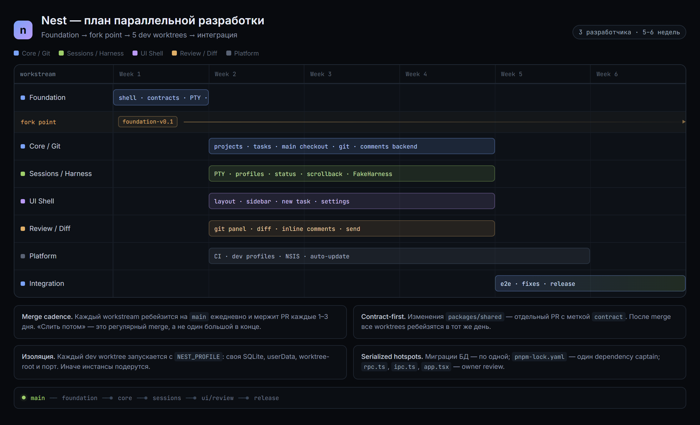

# Nest — параллельная разработка



Это план разработки самого Nest, а не worktree-задач внутри приложения. Термины:

- **dev worktree** — отдельный git worktree для работы над Nest;
- **task worktree** — worktree, который Nest создаёт пользователю для задачи.

## 1. Принцип

Параллелить имеет смысл только после **foundation** — устойчивого каркаса с замороженными контрактами. Если начать параллельно раньше, время уйдёт на конфликты в `packages/shared`, RPC, схеме БД и layout.

```
Foundation (sequential) ──► Fork point ──► Parallel workstreams ──► Integration
      ~1 неделя              tag/checklist       ~2–3 недели          ~1–2 недели
```

До fork point работает один поток. После — 3–5 независимых worktree, которые регулярно сливаются в `main`, а не «в конце».

## 2. Foundation — последовательная фаза

Цель: сделать базу, от которой можно безопасно ответвиться.

### 2.1 Что должно быть готово

- pnpm-монорепо: `apps/desktop`, `packages/core`, `packages/shared`, `packages/ui`.
- Electron + electron-vite + React + TypeScript strict + Tailwind.
- Дизайн-токены: цвета, типографика, отступы, радиусы, размеры колонок.
- Трёхколоночный layout с mock-данными.
- `packages/shared`: zod-схемы и RPC-контракт для projects/tasks/sessions/git/comments.
- `packages/core`: подключение SQLite, baseline-миграция, интерфейсы сервисов, `LocalHost`.
- Один вертикальный срез: добавить проект → открыть main checkout → запустить PTY → увидеть вывод.
- Типизированный IPC: preload + router + `MockRpcClient` для UI-разработки.
- `FakeHarness` для e2e и разработки без реальных агентов.
- Dev-профили для нескольких одновременных worktree.
- CI на Windows: typecheck, lint, unit, build, e2e smoke.
- Разбитые issues и карта владения директориями.

### 2.2 Exit criteria

- [ ] `pnpm install && pnpm dev` работает в чистом dev worktree.
- [ ] Два dev worktree могут работать одновременно, не деля БД и userData.
- [ ] `main` зелёный на Windows.
- [ ] Контракты покрывают все MVP-сценарии.
- [ ] Baseline-миграция применяется с нуля.
- [ ] Один реальный harness стартует в терминале.
- [ ] `FakeHarness` проходит e2e.
- [ ] Нет открытых архитектурных вопросов, блокирующих workstreams.

Фактический статус foundation — в [roadmap.md](roadmap.md#phase-1--foundation-sequential-1-неделя). Foundation собран локально; перед тегом остаются удалённый CI, smoke реального harness и проверка двух профилей.

## 3. Fork point

После merge foundation в `main`:

```bash
git switch main
git pull
git tag foundation-v0.1

git worktree add ../nest-core     -b feat/core     main
git worktree add ../nest-sessions -b feat/sessions main
git worktree add ../nest-ui       -b feat/ui       main
git worktree add ../nest-review   -b feat/review   main
git worktree add ../nest-platform -b chore/platform main
```

Каждый worktree:

```bash
pnpm install
NEST_PROFILE=core pnpm dev
```

Windows PowerShell:

```powershell
pnpm install
$env:NEST_PROFILE="core"; pnpm dev
```

`NEST_PROFILE` обязателен: иначе все инстансы будут писать в один `userData`, одну SQLite и один worktree-root.

### 3.1 Checklist перед fork

- [ ] Контракты в `packages/shared` заморожены на `foundation-v0.1`.
- [ ] `CODEOWNERS` или устная карта владения директориями.
- [ ] Baseline-миграция и правило нумерации миграций.
- [ ] `MockRpcClient` и fixtures для UI.
- [ ] `FakeHarness` и e2e smoke.
- [ ] Dev-профили и скрипты `db:reset`, `seed`.
- [ ] Issues нарезаны так, чтобы каждый workstream владел своими директориями.
- [ ] Договорённость о daily merge, а не big-bang.

## 4. Workstreams

| Workstream | Владеет | Зависит от | Результат |
|---|---|---|---|
| **Core / Git** | `packages/core/src/projects`, `tasks`, `git`, `comments`, миграции | foundation | projects, main checkout, worktree lifecycle, git status/diff/commit/push, comments backend |
| **Sessions / Harness** | `packages/core/src/sessions`, `harness`, `features/terminal` | foundation | PTY lifecycle, harness-профили, статусы, scrollback, resume, FakeHarness |
| **UI Shell** | `renderer/layout`, `features/sidebar`, `features/task-create`, `packages/ui` | foundation + mock RPC | три колонки, дерево, New task, настройки, уведомления, command palette |
| **Review / Diff** | `features/git`, `features/diff`, `features/comments` | foundation + `git.diff`/comments contract | Git-панель, diff viewer, inline-комментарии, отправка в сессию |
| **Platform** | `electron-builder`, CI, auto-update, dev-профили, release scripts | foundation | установщики, подпись, обновление, e2e-матрица |

### 4.1 Граф зависимостей

```
Foundation
├── Core / Git ──────────────┐
├── Sessions / Harness ──────┼──► UI Shell
├── Review / Diff ◄──────────┘
└── Platform (независим)
```

- UI Shell и Review могут стартовать сразу на mock RPC/fixtures.
- Core и Sessions — критический путь; их контракты нельзя ломать без отдельного PR.
- Platform не блокирует фичи, но требует, чтобы `main` собирался.

### 4.2 Что не параллелить

- `packages/shared/src/rpc.ts` — только через contract PR.
- `packages/core/src/index.ts` — composition root, маленькие PR.
- `apps/desktop/src/main/ipc.ts` — router, contract owner.
- `apps/desktop/src/renderer/app.tsx` — UI Shell owner.
- `pnpm-lock.yaml` — dependency captain.
- Миграции БД — строго последовательно.

## 5. Merge strategy

### 5.1 Trunk-based

- `main` всегда зелёный.
- `main` protected: обязательный CI, 1 review, запрет force push.
- Ветки живут 1–3 дня, максимум неделю.
- Rebase на `main` ежедневно.
- Merge — через PR (squash или merge commit), не напрямую.
- Один PR — одна логическая вещь; большой PR дробится.

### 5.2 Порядок merge

1. Contract PR в `packages/shared`.
2. Миграция БД.
3. Backend-сервис.
4. UI-фича.
5. E2E/документация.

Если UI ещё не готов, backend мержится за feature flag.

Если двум workstreams нужен один и тот же файл, сначала один добавляет seam/интерфейс, второй ребейзится и работает через него. Параллельное редактирование одного файла — запрещено.

### 5.3 Contract changes

- Любое изменение RPC/схем — отдельный PR с меткой `contract`.
- После merge все workstreams ребейзятся в тот же день.
- Ломающее изменение — новая версия метода (`v2`) или одновременный PR во все затронутые ветки.
- Contract tests обязательны.

### 5.4 Миграции

- Один PR — одна миграция.
- Номера не переиспользуются, применённые миграции не редактируются.
- При конфликте номеров — ребейз и перенумерация **новой** миграции.
- Каждый worktree имеет свою dev-БД; миграции применяются при старте.

### 5.5 Lockfile и зависимости

- Один «dependency captain» на неделю.
- Остальные не трогают `pnpm-lock.yaml` без согласования.
- После обновления lockfile все ребейзятся и делают `pnpm install`.

### 5.6 Feature flags

Незавершённая фича не ломает `main`:

- `settings.experimental.diffComments`;
- `NEST_FEATURE_COMMENTS=1`;
- скрытая кнопка/таб, пока backend не готов.

### 5.7 Code review

- 1 approve для обычного PR.
- 2 approve для contract/миграции/CI.
- CI обязателен: typecheck, lint, unit, build.
- E2E на `main` и nightly.

### 5.8 Cadence

- Daily 15 min: blockers, contract changes, кто что мержит.
- Weekly demo: каждый workstream показывает работающий сценарий, не слайды.
- Статус — в issue board, без отдельной «отчётности».
- Если ветка не мержилась 2 дня — это сигнал, а не норма.

## 6. Dev worktrees: практика

### 6.1 Изоляция профилей

```bash
NEST_PROFILE=core     pnpm dev
NEST_PROFILE=sessions pnpm dev
NEST_PROFILE=ui       pnpm dev
```

Профиль меняет:

- `app.getPath('userData')` → `userData/profiles/<profile>`;
- `nest.db` → внутри профиля;
- `NEST_WORKTREES_ROOT` → `.../profiles/<profile>/worktrees`;
- порт Vite;
- single-instance lock (в dev отключён или включает профиль).

Без этого два Electron-инстанса подерутся за SQLite и worktree-root.

### 6.2 Скрипты

```json
{
  "dev": "electron-vite dev",
  "dev:core": "cross-env NEST_PROFILE=core electron-vite dev",
  "db:reset": "tsx scripts/db-reset.ts",
  "seed": "tsx scripts/seed.ts",
  "test:e2e": "playwright test"
}
```

### 6.3 Mock RPC и fixtures

- `RpcClient` — интерфейс.
- `IpcRpcClient` — реальный.
- `MockRpcClient` — для UI worktree, с задержками и ошибками.
- Fixtures: проекты, main checkout, задачи, diff, комментарии, сессии.
- UI Shell и Review не ждут backend.

### 6.4 FakeHarness

- Node-скрипт: печатает ANSI, ждёт ввод, выходит с 0/1.
- Используется в e2e и для проверки терминала без Claude/Codex.
- Позволяет тестировать комментарии → отправку в PTY детерминированно.

### 6.5 Dogfooding

На практике dev worktree можно вести в Orca. После того как готовы tasks + terminal:

- можно перевести разработку Nest в dev worktree через сам Nest;
- это не блокирует релиз;
- если Nest падает, работа продолжается в Orca/обычном терминале.

## 7. CI и тесты

На каждый PR:

- typecheck;
- lint;
- unit;
- build;
- contract tests.

На `main`:

- e2e smoke (main checkout, task, terminal, comment);
- проверка миграций с нуля.

Nightly:

- полный e2e на Windows;
- macOS smoke;
- сборка установщика.

## 8. Тайминг

### 3 разработчика

| Неделя | Что |
|---|---|
| 1 | Foundation, все вместе |
| 2–4 | Параллельно: Core, Sessions, UI Shell, Review; Platform — part-time |
| 5 | Интеграция, e2e, багфикс |
| 6 | Буфер, сборка, релиз |

### 2 разработчика

- Foundation — вдвоём.
- Core + Sessions — один, UI Shell + Review — второй.
- Platform — по очереди.
- 5–6 недель.

### 1 разработчик

- Параллельность ограничена: 1–2 dev worktree на независимые задачи.
- 6–7 недель.
- Worktree всё равно полезен: не переключаешь контекст в одном checkout.

## 9. Integration / release

- Merge идёт постоянно; integration phase — стабилизация, а не big-bang.
- За 2 дня до релиза — feature freeze.
- Прогон: Windows 11 (основной), macOS (вторичный), Ubuntu (best effort).
- Проверить: main checkout, worktree task, 2 harness, комментарии → отправка, restart, scrollback.
- Собрать NSIS, подписать, проверить установку на чистой машине.
- После релиза — `git worktree remove` для слитых веток, `git worktree prune`.

## 10. Антипаттерны

- Начать параллельно до foundation.
- Держать ветки неделями.
- Менять `rpc.ts` без contract PR.
- Двум людям править одну миграцию.
- Одновременно обновлять lockfile.
- «Сольём в конце» — большой конфликтный merge.
- UI на mock-данных без даты интеграции.
- Разрешать конфликты в shared-файлах «по интуиции», без owner review.

## 11. Definition of Done для workstream

- Фича работает через реальный RPC, не только mock.
- Есть unit/e2e на критический путь.
- Контракты не изменены без отдельного PR.
- Миграция (если есть) применяется с нуля.
- Feature flag снят или задокументирован.
- Документация обновлена.
- Демо на weekly sync.
