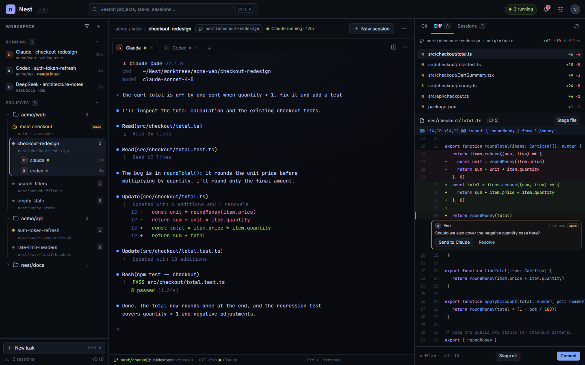
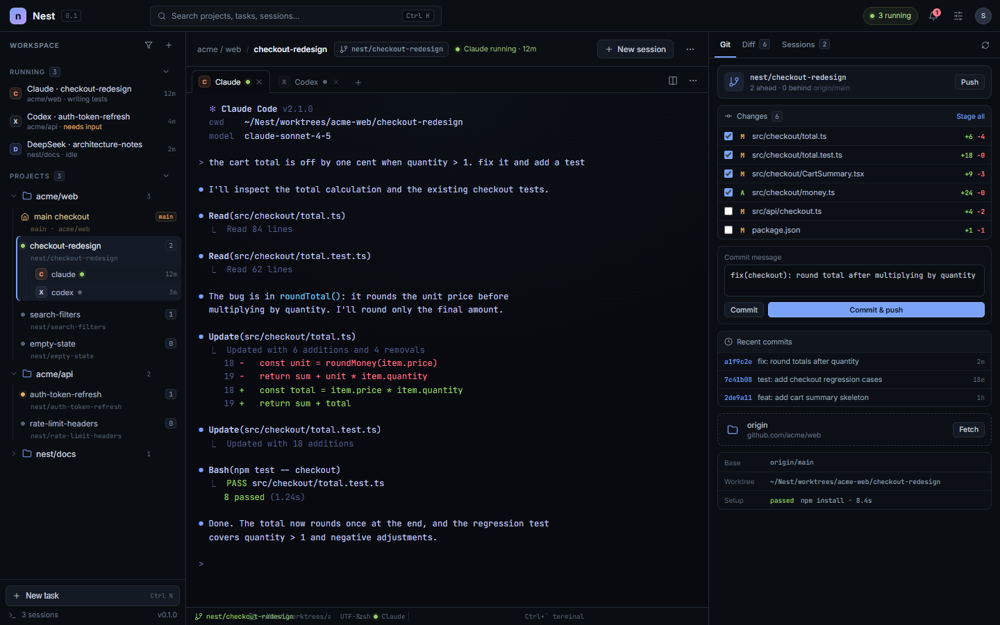
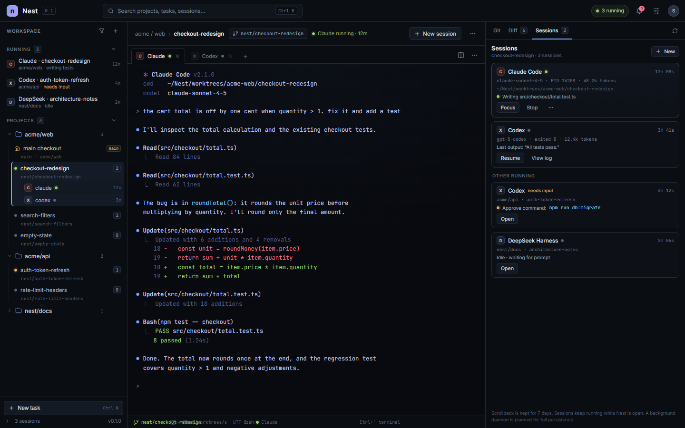
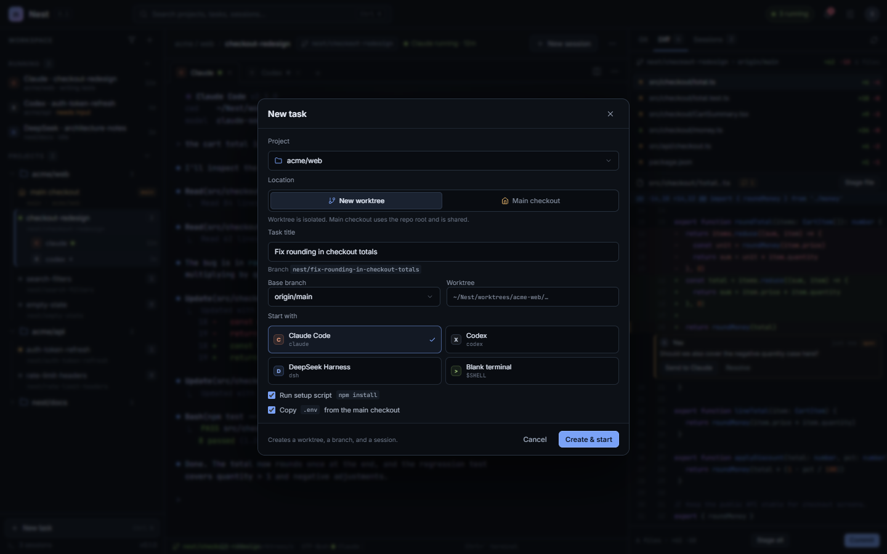

# Nest — продукт

> Рабочее название. Дальше можно переименовать без влияния на архитектуру.

## 1. Что это

Nest — настольное приложение для параллельной работы с CLI-агентами. Оно не заменяет harness и не пытается быть полноценной IDE. Оно даёт три вещи:

1. **Порядок.** Проект → задача → сессия. Всегда понятно, где чей терминал и какой код меняется.
2. **Изоляцию.** Обычная задача живёт в отдельном git worktree и ветке. Плюс всегда доступен основной checkout — для быстрых правок без создания worktree.
3. **Контроль.** Терминал, git, diff и статусы запущенных harness — на одном экране.

Ключевая формула:

```
Project (репозиторий)
├── Main checkout (singleton, без worktree)
│   └── Session (PTY + harness CLI)
└── Task (worktree + branch)
    ├── Session (PTY + harness CLI)
    └── Session (PTY + harness CLI)
```

Nest не делает собственный чат-интерфейс. Центральная область — это настоящий терминал, в котором запущен `claude`, `codex`, `dsh`, `opencode`, `pi`, `copilot` или любой другой CLI. Всё, что умеет harness, работает как есть.

## 2. Позиционирование

Orca — мощный agent development environment: боты, browser, mobile, plugins, remote hosts, нативный чат, split panes. Nest — это «ядро Orca» без всего, что не нужно каждый день.

| Возможность | Orca | Nest (MVP) |
|---|---|---|
| Git worktrees для изолированных задач | да | да |
| Несколько harness-сессий на задачу | да | да |
| Терминал (xterm + PTY) | да | да |
| Git status / diff / commit / push | да | да |
| Комментарии к diff → отправить агенту | да | да |
| Панель сессий и статусов | да | да |
| Нативный чат-интерфейс | да | **нет** |
| Browser / Design Mode | да | **нет** |
| Bots, Slack, Linear, Jira | да | **нет** |
| Плагины и marketplace | да | **нет** |
| Remote / SSH / mobile | да | долгий ящик |
| Split panes | да | позже (сначала обычные табы) |
| Monaco / редактирование файлов | да | позже |
| Аккаунты, usage tracking | да | **нет** |

Nest должен оставаться маленьким: если функцию можно сделать командой в терминале, она не становится отдельной кнопкой.

## 3. Для кого

- Соло-разработчик, который ведёт 2–5 задач параллельно.
- Небольшая команда, где у каждого свой набор worktree и агентов.
- Те, кто уже пользуется Claude Code / Codex / DeepSeek Harness / OpenCode и не хочет менять привычный CLI.
- Windows в первую очередь, macOS во вторую, Linux — по возможности.

Основной сценарий: «я запускаю агента на задачу, ухожу делать другое, возвращаюсь и вижу, что он сделал».

### 3.1 Принятые технические решения

- **Desktop: Electron.** Tauri 2 не входит в MVP, но остаётся как отдельный эксперимент на будущее: если понадобится установщик < 30 МБ или мобильный клиент, можно сделать spike и сравнить на цифрах.
- **Windows-first.** Windows 11 — основной таргет; macOS поддерживаем, Linux — best effort.
- **Main checkout поддерживается.** Один singleton-workspace на проект, без worktree.
- **Без daemon в MVP.** Закрытие окна прячет Nest в трей, CLI/PTY продолжают работать; полный выход завершает PTY, а сессии, которые были живы, при следующем запуске автоматически продолжаются через resume harness. Scrollback сохраняется.
- **Комментарии к diff — в MVP.** Строка diff → комментарий → отправка в активную сессию.
- **PR-провайдеры — позже.** В MVP только commit/push; GitHub/GitLab PR и checks не делаем.
- **Remote/SSH/mobile — долгий ящик.** Сценария нет; не проектируем под него UI и не тратим время.
- **Без отдельного spike.** Orca уже доказала связку Electron + PTY + worktrees; начинаем с Phase 1.
- **Harness-профили MVP:** Claude Code, Codex, DeepSeek Harness, OpenCode, pi, GitHub Copilot CLI, custom.

## 4. Модель данных

### Project

Зарегистрированный git-репозиторий.

- путь к основному checkout;
- имя;
- base ref (обычно `origin/main`);
- настройки: setup script, shared paths, `.env`-файлы;
- main checkout создаётся автоматически при добавлении проекта.

### Task

Единица работы. Обычная задача создаёт отдельный worktree. Отдельный singleton `kind=checkout` представляет основной checkout проекта.

- `kind`: `worktree` (по умолчанию) или `checkout`;
- название и slug;
- ветка (`nest/<slug>` для worktree, текущая ветка для checkout);
- base ref;
- путь к workspace (worktree или корень репозитория);
- статус: `active`, `review`, `done`, `archived` (у main checkout всегда `active`);
- время создания и последней активности.

### Main checkout

Основной checkout — это singleton-workspace проекта, а не обычная задача.

- создаётся автоматически при добавлении проекта;
- один на проект, удалить нельзя (только удалить проект целиком);
- не создаёт worktree и не запускает setup script;
- в нём можно запускать сессии, смотреть diff, stage, commit и push;
- изменения общие с основным checkout, поэтому в UI он помечен бейджем `main`;
- сессий может быть несколько, но вторую задачу на тот же main checkout создать нельзя: если нужна изоляция — создавайте worktree-задачу.

> Правило: **main checkout — для быстрых правок и проверки, worktree — для параллельной работы.** Если над задачей работает агент, который может что-то сломать, лучше worktree.

### Session

Запущенный процесс harness в PTY.

- задача;
- harness-профиль (команда, аргументы, env);
- статус: `starting`, `running`, `idle`, `needs_input`, `exited`, `failed`;
- PID, время старта, длительность, exit code;
- scrollback (raw log + snapshot);
- harness session id, если удалось получить (для resume).

### Harness

Профиль CLI-агента.

- имя и иконка;
- команда и аргументы;
- дополнительные env;
- команда resume;
- опциональные hooks для точного статуса.

Встроенные профили:

| Harness | Команда | Статус в MVP |
|---|---|---|
| Claude Code | `claude` | поддержка есть; у автора нет доступа, реальный smoke — после MVP силами коллег + stub-тесты |
| Codex | `codex` | поддержка и ручной тест |
| DeepSeek Harness | `dsh` | поддержка и ручной тест |
| OpenCode | `opencode` | поддержка и ручной тест |
| pi | `pi` | поддержка |
| GitHub Copilot CLI | `copilot` | поддержка |
| Blank terminal | `$SHELL` / `pwsh` | поддержка |
| Custom command | любая | поддержка |

> Claude Code не требует отдельного API-интеграции: базовый сценарий — обычный PTY-запуск `claude`. Специфичные вещи (resume, hooks, точный статус `needs_input`) делаем best-effort по документации; реальный smoke — после MVP силами коллег. Матрица и протокол — в [harness-compat.md](harness-compat.md).

> Важно: сессия — это не чат. Транскрипт сессии — это scrollback терминала. Мы не парсим сообщения и не строим свою ленту.

## 5. Пользовательские сценарии

### 5.1 Добавить проект

1. Нажать `+` в сайдбаре или «Add project».
2. Выбрать папку.
3. Nest проверяет, что это git-репозиторий, находит base ref.
4. Проект появляется в дереве. Worktree не создаются, ничего не запускается.

### 5.2 Создать задачу

1. `Ctrl+N` или `+` у проекта.
2. В модалке: проект, **location** (`New worktree` / `Main checkout`), название, base branch, агент.
3. Nest показывает будущую ветку и путь.
4. Если выбран `New worktree`, «Create & start»:
   - `git fetch`;
   - `git worktree add -b nest/<slug> <path> <base>`;
   - опционально setup script и копирование `.env`;
   - создаётся сессия и открывается терминал.
5. Если выбран `Main checkout`, worktree не создаётся: открывается существующий main workspace проекта, в нём запускается сессия. Если main checkout уже открыт — просто добавляется ещё одна сессия.
6. Создание worktree идёт в фоне. В сайдбаре видна строка прогресса, можно переключиться на другую задачу.

### 5.3 Работа с агентом

1. Пользователь пишет прямо в терминал.
2. Сайдбар показывает статус: running / idle / needs input / exited.
3. Если агент ждёт подтверждения, в шапке и в системном уведомлении появляется сигнал.
4. Можно открыть вторую сессию на ту же задачу (например, Codex для ревью) — она будет в той же worktree.

### 5.4 Ревью изменений

1. Правая панель → `Diff`.
2. Список файлов со статусами и `+/-`.
3. Unified diff с подсветкой синтаксиса; переключатель side-by-side — позже.
4. Можно stage/unstage файл, посмотреть diff против base ref.
5. Клик по номеру строки открывает комментарий к этой строке.
6. Комментарий сохраняется локально и показывается inline в diff; его можно отредактировать, resolve или удалить. Заметка, чей hunk ушёл из текущего сравнения (staged, committed, другой режим, файл не в этом диффе), остаётся доступной в отдельной области «Outside this patch» с указанием причины — она не считается stale и не исчезает.
7. Один или несколько комментариев можно отправить в активную сессию: Nest форматирует `file:line` + текст и пишет это в PTY. Пакетная отправка берёт все открытые заметки выбранной области и сообщает, сколько ушло.
8. Если живой сессии нет — отправка не проходит молча: показывается причина, заметка копируется в clipboard, и UI предлагает запустить сессию.

### 5.5 Commit / push

1. Правая панель → `Git`.
2. Видно branch, ahead/behind, staged/unstaged.
3. Ввод commit message, `Commit` или `Commit & push`.
4. После push обновляется ahead/behind; ссылка на remote доступна в Git-панели.
5. PR-провайдеры (GitHub/GitLab) и checks — позже, не в MVP.

### 5.6 Мониторинг сессий

1. Секция `Running` в сайдбаре — все активные сессии across projects.
2. Правая панель → `Sessions` — сессии текущей задачи + другие запущенные.
3. Клик по сессии фокусирует её терминал.
4. Для exited-сессии доступны `Resume exact` (по сохранённому id), `Resume latest` (fallback на последнюю беседу) и `View log`.

### 5.7 Возврат к задаче

1. `Ctrl+Shift+P` → имя задачи или сессии.
2. Открывается последняя активная сессия задачи, right panel сохраняет свой таб.
3. Если приложение перезапускалось — метаданные и scrollback восстанавливаются; сессии, живые при полном выходе, автоматически продолжаются в тех же вкладках через resume harness. Закрытие окна не перезапускает сессии: Nest остаётся в трее. Полное выживание PTY после Quit — через фоновый daemon позже.

### 5.8 Работа в основном checkout

1. В дереве проекта всегда есть строка `main checkout` с бейджем `main`.
2. Клик открывает основной checkout; можно запускать сессии, смотреть diff и коммитить.
3. В шапке и в Git-панели явно написано, что это основной checkout, а не изолированный worktree.
4. Если нужна параллельная работа или рискованные изменения — создаётся worktree-задача.

### 5.9 Удаление задачи

1. Правый клик по worktree-задаче → `Delete`.
2. Если есть незакоммиченные изменения — предупреждение со списком файлов.
3. Удаляется worktree; ветка удаляется только по явному выбору.
4. Если git не смог удалить из-за file lock (Windows) — предложить `Force delete` и повторить.
5. `main checkout` удалить нельзя: можно только остановить его сессии или удалить проект целиком.

## 6. Экраны

### 6.1 Workspace



Три зоны:

- **Слева** — `Running` (все живые сессии) и дерево `Projects → Main checkout / Tasks → Sessions`.
- **В центре** — задача (или main checkout), ветка, табы сессий и терминал.
- **Справа** — `Git`, `Diff`, `Sessions` для текущего workspace.

Детали:

- активная задача подсвечена и имеет акцентную полосу;
- `main checkout` помечен бейджем `main` и иконкой дома;
- у сессии есть иконка harness, статус-точка и время;
- в diff можно оставить комментарий к строке и отправить его в активную сессию;
- в шапке терминала — breadcrumb, ветка и статус агента;
- в статус-баре — путь workspace, кодировка, shell, длительность сессии.

### 6.2 Git



- карточка ветки: ahead/behind, push; для main checkout — бейдж `main` и явное предупреждение «это основной checkout»;
- изменения со чекбоксами stage;
- commit message и `Commit & push`;
- последние коммиты;
- карточка remote (`origin`) с fetch;
- информация о worktree/main checkout и setup.

### 6.3 Sessions



- карточки сессий: harness, модель, PID, токены, путь, последняя активность;
- действия: Focus, Stop, Resume, View log;
- секция `Other running` для сессий из других задач;
- статус `needs input` с причиной (например, «Approve command»).

### 6.4 New task



- проект, **location** (`New worktree` / `Main checkout`), название, base branch;
- предпросмотр ветки и пути;
- выбор harness;
- setup script и копирование `.env` (только для worktree);
- одна основная кнопка `Create & start`.

### 6.5 Empty state

Первый запуск, проектов ещё нет:

```
sidebar:  No projects yet.
          Add a git repository

center:   Add your first repository
          Nest creates isolated worktrees for every task.
          [ Add project ]
```

Нет выбранной задачи, но проекты есть: в центре «No task selected» с подсказкой выбрать задачу слева.

Нет сессий у задачи: стартовый экран «Start a harness» с доступными профилями; если на PATH ничего не найдено — подсказка про установку CLI и Fake harness. Если все профили выключены в настройках — «Every harness profile is disabled» и ссылка в Settings.

Нет изменений: Git — «Working tree is clean», Diff — «No changes to review»; ошибка чтения статуса или diff показывается в панели с кнопкой `Try again`.

### 6.6 Command palette

`Ctrl+Shift+P` (не `Ctrl+K`: в шелле это kill-line, и Nest не отбирает его у терминала):

- задачи и сессии по имени;
- запуск доступного harness, stop/resume текущей сессии;
- переключение панелей Git / Diff / Sessions;
- команды: `New task`, `Add project`, `Settings`, `Reveal workspace`, `Refresh git`;
- переход к файлу — позже.

### 6.7 Settings и обновления

⚙ в статусбаре открывает настройки:

- вкл/выкл встроенных harness-профилей; отключённый профиль скрыт из стартовых списков, но существующие сессии продолжают resume;
- custom-команда: путь или имя в `PATH`, запускается без аргументов;
- update feed — URL статического каталога с `latest.yml`; пустое значение выключает проверки; публичный feed только HTTPS, HTTP допустим для localhost;
- статус обновлений: текущая версия, «up to date», загрузка с процентом, «ready», ошибка; кнопки `Check now` и `Install and restart`;
- при готовом обновлении в статусбаре появляется бейдж «Update ready», а в command palette — команда установки.

Обновления проверяются только в упакованной сборке: через 20 секунд после старта и раз в 6 часов. `NEST_UPDATE_URL` перекрывает feed из настроек.

## 7. Функциональные требования

Приоритеты: **P0** — без этого нет MVP, **P1** — сразу после MVP, **P2** — позже.

| ID | Требование | Приоритет |
|---|---|---|
| FR-01 | Добавление/удаление проекта, проверка git-репозитория, определение base ref | P0 |
| FR-02 | Создание задачи: worktree + ветка, асинхронно, с прогрессом и rollback при ошибке | P0 |
| FR-02a | Main checkout: singleton на проект, автосоздание, сессии, diff/commit/push, запрет удаления | P0 |
| FR-03 | Дерево проектов/main checkout/задач/сессий, секция Running, фильтр, клавиатурная навигация | P0 |
| FR-04 | Запуск произвольного harness CLI в PTY, несколько сессий на задачу | P0 |
| FR-05 | Терминал: xterm, resize, copy/paste, search, links, scrollback | P0 |
| FR-06 | Статусы сессий: starting/running/idle/exited/failed; needs_input через hooks | P0 |
| FR-07 | Git status: branch, ahead/behind, staged/unstaged/untracked | P0 |
| FR-08 | Diff: список файлов, unified diff, подсветка, stage/unstage | P0 |
| FR-09 | Commit и push | P0 |
| FR-10 | Панель Sessions: список, focus, stop, restart/resume, view log | P0 |
| FR-11 | SQLite-персистентность задач и сессий; восстановление scrollback. PTY завершается вместе с приложением, живые сессии автоматически возобновляются через resume | P0 |
| FR-12 | Настройки: harness-профили (Claude Code, Codex, DSH, OpenCode, pi, Copilot, custom), worktree root, тема, setup hooks | P0 |
| FR-13 | PR-провайдер (GitHub/GitLab) и checks — позже | P2 |
| FR-14 | Системные уведомления: needs input, exit, failure | P1 |
| FR-15 | Command palette | P1 |
| FR-16 | Комментарии к строкам diff: создание, inline, resolve, отправка в активную сессию | P0 |
| FR-17 | Resume harness-сессии после exit/restart | P1 |
| FR-18 | Setup script, копирование `.env`, shared dirs (`node_modules`) | P1 |
| FR-19 | Статусы задачи и архив | P1 |
| FR-20 | Split panes (терминал + diff рядом) | P2 |
| FR-21 | Remote/SSH host | долгий ящик |
| FR-22 | Mobile companion | долгий ящик |
| FR-23 | Native chat UI | P2 |
| FR-24 | Browser / Design Mode | P2 |
| FR-25 | Плагины | P2 |

### 7.1 Нефункциональные требования

| ID | Требование |
|---|---|
| NFR-01 | Холодный старт до интерактивного UI — < 1.5 с; сессии догружаются прогрессивно |
| NFR-02 | Ввод в терминал → вывод — p95 < 50 мс; переключение задачи — < 100 мс |
| NFR-03 | 10 параллельных сессий без деградации; idle RAM с 3 сессиями — < 300 МБ |
| NFR-04 | Работа offline; никаких обязательных сетевых вызовов |
| NFR-05 | Windows-first: Windows 11 — основной таргет и приоритет в тестах; macOS — вторичный; Linux — best effort |
| NFR-06 | Все данные локальны; телеметрия выключена по умолчанию |
| NFR-07 | Renderer изолирован: sandbox, contextIsolation, allowlist IPC |
| NFR-08 | Ошибки git/PTY не роняют приложение; сессия и задача остаются в консистентном состоянии |
| NFR-09 | Обновление через HTTPS |
| NFR-10 | Клавиатурная навигация для основных сценариев; фокус видим |
| NFR-11 | В MVP нет фонового daemon: закрытие окна прячет приложение в трей и PTY продолжают работать; полный выход завершает PTY, живые сессии автоматически возобновляются через resume, метаданные и scrollback сохраняются |

## 8. UX-правила

1. **Три колонки — база.** Сайдбары можно свернуть, но не переставлять местами.
2. **Одно главное действие на экран.** В модалке новой задачи — `Create & start`; в diff — `Commit`.
3. **Статус — это точка + текст.** Цвет не единственный носитель смысла.
4. **Опасные действия — с последствиями.** Удаление worktree показывает незакоммиченные файлы.
5. **Никаких блокирующих загрузок.** Создание worktree, fetch и git status идут в фоне.
6. **Клавиатура first.** `Ctrl+Shift+P` — палитра, `Ctrl+N` — новая задача, `Ctrl+W` — закрыть вкладку, `Ctrl+Tab`/`Ctrl+Shift+Tab` — переключение вкладок, `Ctrl+`` — фокус в терминал. Пока фокус в терминале, `Ctrl+N` и `Ctrl+W` остаются шеллу (history-next / kill-word).
7. **Ошибки — с действием.** Не «Something went wrong», а текст + `Retry` / `Open terminal`.
8. **Не прятать терминал.** Любые панели — вокруг терминала, не вместо него.
9. **Минимум модалок.** Модалка только для создания задачи и подтверждения удаления.
10. **Никакой телеметрии по умолчанию.**
11. **Минимальное окно — 1100×700.** При нехватке ширины правая панель уходит в drawer, сайдбар — в overlay; терминал остаётся.
12. **Main checkout явно помечен.** Бейдж `main` и предупреждение в Git-панели; пользователь всегда понимает, что работает в общем checkout, а не в изолированном worktree.
13. **Комментарии к diff не блокируют commit.** Отправка в агент — явное действие; комментарии можно оставить открытыми или resolved.

## 9. Метрики

- время от добавления проекта до первой запущенной сессии — < 60 секунд;
- переключение задачи — < 100 мс;
- корректный статус сессии — > 95% (с hooks) / > 80% (без hooks);
- crash-free sessions — > 99%;
- idle RAM с 3 сессиями — < 300 МБ;
- ввод в терминал → вывод — p95 < 50 мс.

## 10. Что сознательно не делаем

- Свой чат и парсинг ответов агента.
- Встроенный браузер.
- Bots/Slack/Linear/Jira.
- Marketplace плагинов.
- Свой редактор кода.
- Синхронизацию с облаком.
- Аккаунты и биллинг.
- Автоматическое управление агентами («оркестратор»).
- Фоновый daemon и выживание PTY-сессий после закрытия приложения (P2).
- PR-провайдеры (GitHub/GitLab) и checks — позже.
- Remote/SSH/mobile — долгий ящик, сценария нет.

Это не значит «никогда». Это значит «не в MVP».
